# Commit Ready source preparation and handoff

## Qualification

This definition requires destination-specific qualification. Source repository approval and evidence do not transfer. The draft grants no execution authority.

## Workflow contract

```workflow-json
{
  "schema_version": 1,
  "purpose": "Make one authorised interactive conversation or approved daily staging batch source-ready, with verified capture, bounded learning, scratch close-out and continuation handoff.",
  "trigger": "Explicit interactive request for FLOW-0001 source preparation, a declared source-preparation call from an explicitly invoked already-approved parent, or the enabled approved daily schedule naming PLAY-0059 and PLAY-0056; construction of this definition is not invocation.",
  "scope": "the configured Library repository staging source and the invoking AI session task-owned scratch; PLAY-0059 phase contract and PLAY-0041 bounded learning.",
  "non_goals": [
    "PLAY-0056, candidate validation, merge, deployment, sends, new schedules or unrelated Actions. Only the existing serialized ID-reservation issue/workflow needed by this source pack is permitted under source-create authority.",
    "Moving existing assets into a new type or asserting six separate readiness Playbooks."
  ],
  "inputs": [
    "Verified invocation authority/source, current canonical work owner and used plan, complete capability contracts, live main/staging heads and exact actor/access evidence.",
    "Interactive retained conversation or scheduled resolved-batch boundary/provenance; proposed source items and session-owned scratch.",
    "Snapshot original and proposed routing/benchmark/relationship/ID datasets and source catalogue bytes/hashes as run inputs. Use pinned validators on proposed inputs, preserve existing assertions and obtain required independent mutation acceptance. Work/customer/ledger/native-output data are not frozen resources. An own expected-head advance cannot retain admission after any frozen definition/dependency/policy/resource changes.",
    "scratch_mode is exactly source_closeout for ordinary preparation, or defer_until_validated supplied by the admitted FLOW-0002 Cleanup entry; preserve that mode in every phase/result. Unknown/missing/contradictory supplied mode is failure, not a default.",
    "Ordinary source_closeout retains its previous per-invocation limit of 20 transitions; Cleanup deferred mode has at most 22, always capped by the parent's remaining shared allowance."
  ],
  "outputs": [
    "Verified staged source pack, applicable source-check evidence, truthful cleanup disposition and the required compact result return; continuation prompt only on explicit request.",
    "Exactly one final service outcome: completed source preparation or awaiting_steve with the evidenced handoff/cancellation acknowledgement and preserved partial effects; candidate acceptance remains a separate gate.",
    "source_result=changed or unchanged with the actual exact head, scoped source/capture proof and actual effects; unchanged means no source commit or unnecessary allocation occurred."
  ],
  "authority": "No execution authority comes from this reusable definition. Interactive source writes need the explicit PLAY-0059 request or the declared source-preparation call under an explicitly invoked approved parent; daily route needs its enabled approved schedule. PLAY-0056 remains separately gated even if the daily schedule later authorises it; this workflow stops before that handoff.",
  "completion": "All required source phases succeed within the same stable scope through either guarded changed-source save/readback or verified unchanged-source return, then required scratch disposition and handoff. Report actual source_result/head/effects. Source readiness is not candidate acceptance. In defer_until_validated mode, success requires verified scratch_result=deferred and a complete exact-file preservation/disposition packet, with zero scratch deletions; this source-only return is not Cleanup completion. The parent owns validation and PLAY-0075 close-out.",
  "persistence": "The invoking Ticket/Project and its used plan, or existing canonical subject/run output when no work record exists. The destination owns qualification evidence; reusable definition contains no mutable run state.",
  "risks": [
    "No admitted end-to-end live run has occurred. Qualified primitives/operator procedures and exact independent acceptance support a first live pilot; they do not establish measured integrated runtime performance or automatically enforced operator behaviour.",
    "A phase is a named slice of its governing Playbook; operator must preserve cumulative scope/effects and never rerun the whole Playbook at each state.",
    "Direct source-write APIs still require fresh SHA and verified non-force/fast-forward behaviour; unavailable guards block the write."
  ],
  "grill_me": "SKILL-0318",
  "entry": "stabilise",
  "max_transitions": 22,
  "steps": [
    {
      "id": "stabilise",
      "kind": "playbook",
      "playbook": "PLAY-0059",
      "owner": "HAT-0001",
      "actor_access": "Authorised AI operator using the connected the configured Library repository GitHub identity and its own session scratch. Verify exact repository write permission, target SHA, staging/main heads and local file ownership when needed; access is per-run evidence, never inherited from this definition.",
      "scope": "First operating action: read/apply the opening briefing in Workflows/README.md Mandatory operating briefings against this exact definition and current run evidence; minimal identification/instruction reads may precede it. PLAY-0059 phase Method2 only; resolve a stable runtime batch before inventory. Permitted operations only: read current main/staging and relevant active run once; wait under a declared interval/deadline when required; verify only permitted allocator/reconciler provenance. Excluded: unrelated work and any optional operation/effect outside this phase.",
      "prerequisites": [
        "Invocation evidence satisfies this contract's trigger/authority and Playbooks/PLAY-0059-commit-ready.md, Manual FLOW operator gate, for stabilise.",
        "The current root/child run ledger satisfies Playbooks/PLAY-0059-commit-ready.md, Manual FLOW operator gate, and Approved parent invocation and return, for stabilise."
      ],
      "inputs": [
        "Explicit invocation authority and main/staging/active-run evidence.",
        "Required phase evidence: live head IDs, relevant run outcome and allowed-advance proof. Reuse existing applicable receipts after exact identity/freshness checks."
      ],
      "outputs": [
        "Stable batch SHA, main SHA, active-run status, authority and provenance recorded."
      ],
      "allowed_effects": [
        "Only the named phase effects within the current authority; no main writes, candidate validation, merge, deployment, communication or new schedule."
      ],
      "success_check": "No in-flight candidate/reconciler run; heads read after any wait; all allowed advances proved under PLAY-0059. Overlap, changed main, unknown provenance or repeated instability blocks. Apply Workflows/README.md, Minimum necessary execution contract, at acceptance.",
      "recovery": "For stabilise failure, apply this contract's failure_handling bindings before its declared failure edge; evaluate the originating operation through failure_handling.continuation.",
      "max_attempts": 1,
      "controls": [
        {
          "requirement": "On entering stabilise, apply Workflows/README.md, Mandatory operating briefings to this step's scope, prerequisites, inputs, allowed_effects, success_check and recovery.",
          "mode": "instruction",
          "evidence": "PLAY-0059 governing phase; this exact step contract and actual existing-run evidence/decision pointers. A read tick is not proof.",
          "critical": true
        },
        {
          "requirement": "For stabilise, apply Playbooks/PLAY-0059-commit-ready.md, Manual FLOW operator gate, to this step's actual actor_access, prerequisites and intended effects.",
          "mode": "instruction",
          "evidence": "AGENTS.md; PLAY-0059 Method and Checks and branches; per-run operator evidence required.",
          "critical": true
        },
        {
          "requirement": "Apply Playbooks/PLAY-0059-commit-ready.md, Manual FLOW operator gate, to stabilise using this contract's max_transitions and this step's max_attempts; the current parent allowance is a run input.",
          "mode": "instruction",
          "evidence": "PLAY-0059 Manual FLOW operator gate; representative operator-decision and real-boundary primitive evidence is required for approval. This is a manual procedure, not installed enforcement or an admitted whole-FLOW run.",
          "critical": true
        },
        {
          "requirement": "Apply Workflows/README.md, Minimum necessary execution contract, to stabilise's declared operations, evidence, acceptance and any proposed additional work.",
          "mode": "instruction",
          "evidence": "This exact phase scope/input/output/success/recovery contract and actual run receipts; record a qualifying reason before extra work. Not automatic runtime enforcement.",
          "critical": true
        }
      ],
      "uses": "PLAY-0059",
      "capabilities": [],
      "next": "inventory",
      "failure": "awaiting_steve"
    },
    {
      "id": "inventory",
      "kind": "playbook",
      "playbook": "PLAY-0059",
      "owner": "HAT-0001",
      "actor_access": "Authorised AI operator using the connected the configured Library repository GitHub identity and its own session scratch. Verify exact repository write permission, target SHA, staging/main heads and local file ownership when needed; access is per-run evidence, never inherited from this definition.",
      "scope": "PLAY-0059 Method1/3; source inventory, folder guides and capability assembly only. Permitted operations only: inventory this conversation or the authorised scheduled batch; load required capabilities/type guides; identify accepted durable items, existing owners, planned targets and scratch dispositions. Excluded: unrelated work and any optional operation/effect outside this phase.",
      "prerequisites": [
        "Invocation evidence satisfies this contract's trigger/authority and Playbooks/PLAY-0059-commit-ready.md, Manual FLOW operator gate, for inventory.",
        "The current root/child run ledger satisfies Playbooks/PLAY-0059-commit-ready.md, Manual FLOW operator gate, and Approved parent invocation and return, for inventory."
      ],
      "inputs": [
        "Stable run baseline and interactive conversation or daily changed work records with retained provenance.",
        "Required phase evidence: current request/batch identity, bounded source inventory, exact target/guide/capability identities and frozen-write comparison. Reuse existing applicable receipts after exact identity/freshness checks."
      ],
      "outputs": [
        "Every durable item classified; current canonical owner, required ID, companions, links and authority identified."
      ],
      "allowed_effects": [
        "Only the named phase effects within the current authority; no main writes, candidate validation, merge, deployment, communication or new schedule."
      ],
      "success_check": "No inaccessible source is represented as read. Required capability contracts and all confirmed associations are assessed; material unknowns block affected actions. Establish actual planned write/effect paths; read-only planned-write admission must reject overlap with definition/component/policy/resource and every qualification evidence path, including called workflows. The mutable owner/plan must not be qualification proof. Apply Workflows/README.md, Minimum necessary execution contract, at acceptance.",
      "recovery": "For inventory failure, apply this contract's failure_handling bindings before its declared failure edge; evaluate the originating operation through failure_handling.continuation.",
      "max_attempts": 1,
      "controls": [
        {
          "requirement": "On entering inventory, apply Workflows/README.md, Mandatory operating briefings to this step's scope, prerequisites, inputs, allowed_effects, success_check and recovery.",
          "mode": "instruction",
          "evidence": "PLAY-0059 governing phase; this exact step contract and actual existing-run evidence/decision pointers. A read tick is not proof.",
          "critical": true
        },
        {
          "requirement": "For inventory, apply Playbooks/PLAY-0059-commit-ready.md, Manual FLOW operator gate, to this step's actual actor_access, prerequisites and intended effects.",
          "mode": "instruction",
          "evidence": "AGENTS.md; PLAY-0059 Method and Checks and branches; per-run operator evidence required.",
          "critical": true
        },
        {
          "requirement": "Apply Playbooks/PLAY-0059-commit-ready.md, Manual FLOW operator gate, to inventory using this contract's max_transitions and this step's max_attempts; the current parent allowance is a run input.",
          "mode": "instruction",
          "evidence": "PLAY-0059 Manual FLOW operator gate; representative operator-decision and real-boundary primitive evidence is required for approval. This is a manual procedure, not installed enforcement or an admitted whole-FLOW run.",
          "critical": true
        },
        {
          "requirement": "Apply Workflows/README.md, Minimum necessary execution contract, to inventory's declared operations, evidence, acceptance and any proposed additional work.",
          "mode": "instruction",
          "evidence": "This exact phase scope/input/output/success/recovery contract and actual run receipts; record a qualifying reason before extra work. Not automatic runtime enforcement.",
          "critical": true
        }
      ],
      "uses": "PLAY-0059",
      "capabilities": [],
      "next": "mode",
      "failure": "awaiting_steve"
    },
    {
      "id": "mode",
      "kind": "decision",
      "playbook": "PLAY-0059",
      "owner": "HAT-0001",
      "actor_access": "Authorised AI operator using the connected the configured Library repository GitHub identity and its own session scratch. Verify exact repository write permission, target SHA, staging/main heads and local file ownership when needed; access is per-run evidence, never inherited from this definition.",
      "scope": "PLAY-0059 Invocation decision and result return: read exact current request, cancellation and verified run-source evidence only. Cancellation is a global immediate override; otherwise evaluate mutually exclusive scheduled/interactive predicates. No clock/title-based authority or source/trigger effect.",
      "prerequisites": [
        "Invocation evidence satisfies this contract's trigger/authority and Playbooks/PLAY-0059-commit-ready.md, Manual FLOW operator gate, for mode.",
        "The current root/child run ledger satisfies Playbooks/PLAY-0059-commit-ready.md, Manual FLOW operator gate, and Approved parent invocation and return, for mode."
      ],
      "inputs": [
        "Verified invocation authority and bounded inventory.",
        "Required phase evidence: actual request/cancellation or enabled approved schedule evidence and the selected existing branch. Reuse existing applicable receipts after exact identity/freshness checks."
      ],
      "outputs": [
        "Exactly one evidence-backed interactive or daily route, or internal stopped-attempt evidence routed through shared recovery to awaiting_steve; explicit cancellation receives immediate acknowledgement."
      ],
      "allowed_effects": [
        "Only the named phase effects within the current authority; no main writes, candidate validation, merge, deployment, communication or new schedule."
      ],
      "success_check": "Cancellation overrides normal rules immediately. Otherwise complete verified normal evidence selects daily_learning or assemble. Authoritative complete no-authorised-mode evidence selects otherwise only after shared investigation identifies a genuine owner handoff; no invented question. Missing/stale/contradictory/unreadable evidence or evaluation failure takes failure/shared recovery, never otherwise. Record actual selected predicate/evidence and take its edge immediately.",
      "recovery": "For mode failure, apply this contract's failure_handling bindings before its declared failure edge; evaluate the originating operation through failure_handling.continuation.",
      "max_attempts": 1,
      "controls": [
        {
          "requirement": "On entering mode, apply Workflows/README.md, Mandatory operating briefings to this step's scope, prerequisites, inputs, allowed_effects, success_check and recovery.",
          "mode": "instruction",
          "evidence": "PLAY-0059 governing phase; this exact step contract and actual existing-run evidence/decision pointers. A read tick is not proof.",
          "critical": true
        },
        {
          "requirement": "For mode, apply Playbooks/PLAY-0059-commit-ready.md, Manual FLOW operator gate, to this step's actual actor_access, prerequisites and intended effects.",
          "mode": "instruction",
          "evidence": "AGENTS.md; PLAY-0059 Method and Checks and branches; per-run operator evidence required.",
          "critical": true
        },
        {
          "requirement": "Apply Playbooks/PLAY-0059-commit-ready.md, Manual FLOW operator gate, to mode using this contract's max_transitions and this step's max_attempts; the current parent allowance is a run input.",
          "mode": "instruction",
          "evidence": "PLAY-0059 Manual FLOW operator gate; representative operator-decision and real-boundary primitive evidence is required for approval. This is a manual procedure, not installed enforcement or an admitted whole-FLOW run.",
          "critical": true
        },
        {
          "requirement": "Apply Workflows/README.md, Minimum necessary execution contract, to mode's declared operations, evidence, acceptance and any proposed additional work.",
          "mode": "instruction",
          "evidence": "This exact phase scope/input/output/success/recovery contract and actual run receipts; record a qualifying reason before extra work. Not automatic runtime enforcement.",
          "critical": true
        }
      ],
      "branches": [
        {
          "when": "the Library owner explicitly cancels: immediate global override before all normal predicates; stop effects and acknowledge.",
          "to": "awaiting_steve"
        },
        {
          "when": "No cancellation; complete verified evidence proves this is the enabled approved daily scheduled invocation explicitly naming PLAY-0059 and PLAY-0056.",
          "to": "daily_learning"
        },
        {
          "when": "No cancellation; complete verified evidence proves the current authorised interactive request or approved-parent source call, and this is not the scheduled invocation.",
          "to": "assemble"
        },
        {
          "when": "otherwise",
          "to": "awaiting_steve"
        }
      ],
      "failure": "awaiting_steve"
    },
    {
      "id": "daily_learning",
      "kind": "playbook",
      "playbook": "PLAY-0041",
      "owner": "HAT-0008",
      "actor_access": "Authorised AI operator using the connected the configured Library repository GitHub identity and its own session scratch. Verify exact repository write permission, target SHA, staging/main heads and local file ownership when needed; access is per-run evidence, never inherited from this definition.",
      "scope": "PLAY-0059 Scheduled learning review using PLAY-0041 for this resolved batch only; no estate audit. Permitted operations only: assess only the resolved batch/provenance; compare plausible current Skill owners; retain, amend or reserve only a verified necessary learning capture. Excluded: unrelated work and any optional operation/effect outside this phase.",
      "prerequisites": [
        "Invocation evidence satisfies this contract's trigger/authority and Playbooks/PLAY-0059-commit-ready.md, Manual FLOW operator gate, for daily_learning.",
        "The current root/child run ledger satisfies Playbooks/PLAY-0059-commit-ready.md, Manual FLOW operator gate, and Approved parent invocation and return, for daily_learning."
      ],
      "inputs": [
        "Batch boundary/changed owners, persisted provenance, current Skill catalogue and existing learning dispositions.",
        "Required phase evidence: resolved batch/source anchors, owner comparison and kept/changed/deferred disposition. Reuse existing applicable receipts after exact identity/freshness checks."
      ],
      "outputs": [
        "Deduplicated kept/amended/created/deferred learning assessment and bounded source amendments or exact capture blocker."
      ],
      "allowed_effects": [
        "Only the named phase effects within the current authority; no main writes, candidate validation, merge, deployment, communication or new schedule."
      ],
      "success_check": "Preserve occurrence evidence, purpose and authority; verify reusable capture and independent acceptance requirements. Missing material verified capture blocks learning-complete claim. Apply Workflows/README.md, Minimum necessary execution contract, at acceptance.",
      "recovery": "For daily_learning failure, apply this contract's failure_handling bindings before its declared failure edge; evaluate the originating operation through failure_handling.continuation.",
      "max_attempts": 1,
      "controls": [
        {
          "requirement": "On entering daily_learning, apply Workflows/README.md, Mandatory operating briefings to this step's scope, prerequisites, inputs, allowed_effects, success_check and recovery.",
          "mode": "instruction",
          "evidence": "PLAY-0041 governing phase; this exact step contract and actual existing-run evidence/decision pointers. A read tick is not proof.",
          "critical": true
        },
        {
          "requirement": "For daily_learning, apply Playbooks/PLAY-0059-commit-ready.md, Manual FLOW operator gate, to this step's actual actor_access, prerequisites and intended effects.",
          "mode": "instruction",
          "evidence": "AGENTS.md; PLAY-0059 Method and Checks and branches; per-run operator evidence required.",
          "critical": true
        },
        {
          "requirement": "Apply Playbooks/PLAY-0059-commit-ready.md, Manual FLOW operator gate, to daily_learning using this contract's max_transitions and this step's max_attempts; the current parent allowance is a run input.",
          "mode": "instruction",
          "evidence": "PLAY-0059 Manual FLOW operator gate; representative operator-decision and real-boundary primitive evidence is required for approval. This is a manual procedure, not installed enforcement or an admitted whole-FLOW run.",
          "critical": true
        },
        {
          "requirement": "Apply Workflows/README.md, Minimum necessary execution contract, to daily_learning's declared operations, evidence, acceptance and any proposed additional work.",
          "mode": "instruction",
          "evidence": "This exact phase scope/input/output/success/recovery contract and actual run receipts; record a qualifying reason before extra work. Not automatic runtime enforcement.",
          "critical": true
        }
      ],
      "uses": "PLAY-0041",
      "capabilities": [],
      "next": "assemble",
      "failure": "awaiting_steve"
    },
    {
      "id": "assemble",
      "kind": "playbook",
      "playbook": "PLAY-0059",
      "owner": "HAT-0001",
      "actor_access": "Authorised AI operator using the connected the configured Library repository GitHub identity and its own session scratch. Verify exact repository write permission, target SHA, staging/main heads and local file ownership when needed; access is per-run evidence, never inherited from this definition.",
      "scope": "PLAY-0059 Method4/5: assemble authored source and mandatory companions. Before authored source saving, permit only necessary serialized ID reservation using the existing issue route; this may create allocator-owned receipt commits. Permitted operations only: reuse existing accepted source; prepare only missing/changed authorised source and required companions/reciprocal links; request only necessary serialized IDs and verify its ledger-only advance. Excluded: unrelated work and any optional operation/effect outside this phase.",
      "prerequisites": [
        "Invocation evidence satisfies this contract's trigger/authority and Playbooks/PLAY-0059-commit-ready.md, Manual FLOW operator gate, for assemble.",
        "The current root/child run ledger satisfies Playbooks/PLAY-0059-commit-ready.md, Manual FLOW operator gate, and Approved parent invocation and return, for assemble."
      ],
      "inputs": [
        "Classified durable items and any bounded learning changes.",
        "Required phase evidence: accepted input identities, confirmed relationships, allocation receipt if needed, complete intended source pack and exact expected head. Reuse existing applicable receipts after exact identity/freshness checks."
      ],
      "outputs": [
        "Source pack with consumed allocator receipts, live schemas, reciprocal relationships and required native/routing companions."
      ],
      "allowed_effects": [
        "Read and prepare scoped authored source; request only necessary permanent IDs through the existing serialized reservation issue/workflow. No manual ledger edit, candidate Actions, main write or authored source save in this phase."
      ],
      "success_check": "No guessed IDs, secrets, unconfirmed Artifact promotion, generated-view edits or unrelated opportunistic changes. Allocation unavailable blocks. After allocation, verify returned IDs and receipt, main unchanged, ancestor continuity and exact ledger-only diff matching this request. Record old/new baseline and provenance; advance expected staging head only for that proved own allocator receipt. Any other movement stops; never adopt unrelated work. Apply Workflows/README.md, Minimum necessary execution contract, at acceptance.",
      "recovery": "For assemble failure, apply this contract's failure_handling bindings before its declared failure edge; evaluate the originating operation through failure_handling.continuation.",
      "max_attempts": 1,
      "controls": [
        {
          "requirement": "On entering assemble, apply Workflows/README.md, Mandatory operating briefings to this step's scope, prerequisites, inputs, allowed_effects, success_check and recovery.",
          "mode": "instruction",
          "evidence": "PLAY-0059 governing phase; this exact step contract and actual existing-run evidence/decision pointers. A read tick is not proof.",
          "critical": true
        },
        {
          "requirement": "For assemble, apply Playbooks/PLAY-0059-commit-ready.md, Manual FLOW operator gate, to this step's actual actor_access, prerequisites and intended effects.",
          "mode": "instruction",
          "evidence": "AGENTS.md; PLAY-0059 Method and Checks and branches; per-run operator evidence required.",
          "critical": true
        },
        {
          "requirement": "Apply Playbooks/PLAY-0059-commit-ready.md, Manual FLOW operator gate, to assemble using this contract's max_transitions and this step's max_attempts; the current parent allowance is a run input.",
          "mode": "instruction",
          "evidence": "PLAY-0059 Manual FLOW operator gate; representative operator-decision and real-boundary primitive evidence is required for approval. This is a manual procedure, not installed enforcement or an admitted whole-FLOW run.",
          "critical": true
        },
        {
          "requirement": "Apply Workflows/README.md, Minimum necessary execution contract, to assemble's declared operations, evidence, acceptance and any proposed additional work.",
          "mode": "instruction",
          "evidence": "This exact phase scope/input/output/success/recovery contract and actual run receipts; record a qualifying reason before extra work. Not automatic runtime enforcement.",
          "critical": true
        }
      ],
      "uses": "PLAY-0059",
      "capabilities": [],
      "next": "readiness",
      "failure": "awaiting_steve"
    },
    {
      "id": "readiness",
      "kind": "playbook",
      "playbook": "PLAY-0059",
      "owner": "HAT-0006",
      "actor_access": "Authorised AI operator using the connected the configured Library repository GitHub identity and its own session scratch. Verify exact repository write permission, target SHA, staging/main heads and local file ownership when needed; access is per-run evidence, never inherited from this definition.",
      "scope": "PLAY-0059 Method6 and Readiness gate, scoped to source checks rather than candidate validation. Permitted operations only: perform only the applicable source-readiness gates and planned-write check; verify capture/cleanup dispositions; correct only an authorised failed source requirement. Excluded: unrelated work and any optional operation/effect outside this phase.",
      "prerequisites": [
        "Invocation evidence satisfies this contract's trigger/authority and Playbooks/PLAY-0059-commit-ready.md, Manual FLOW operator gate, for readiness.",
        "The current root/child run ledger satisfies Playbooks/PLAY-0059-commit-ready.md, Manual FLOW operator gate, and Approved parent invocation and return, for readiness."
      ],
      "inputs": [
        "Complete source pack, current schema/ID/link facts and exact task-owned scratch disposition plan.",
        "Required phase evidence: applicable source-check receipts, planned-write result and source inventory/cleanup plan; candidate execution remains excluded. Reuse existing applicable receipts after exact identity/freshness checks."
      ],
      "outputs": [
        "Named applicable source checks/results and no unresolved source defect; cleanup prerequisites/dispositions assessed."
      ],
      "allowed_effects": [
        "Only the named phase effects within the current authority; no main writes, candidate validation, merge, deployment, communication or new schedule."
      ],
      "success_check": "All applicable source readiness checks pass. Do not run candidate-ready, PLAY-0056 or Actions; full-scope classification is retained for later authorised validation. Establish actual planned write/effect paths; read-only planned-write admission must reject overlap with definition/component/policy/resource and every qualification evidence path, including called workflows. The mutable owner/plan must not be qualification proof. Apply Workflows/README.md, Minimum necessary execution contract, at acceptance.",
      "recovery": "For readiness failure, apply this contract's failure_handling bindings before its declared failure edge; evaluate the originating operation through failure_handling.continuation.",
      "max_attempts": 1,
      "controls": [
        {
          "requirement": "On entering readiness, apply Workflows/README.md, Mandatory operating briefings to this step's scope, prerequisites, inputs, allowed_effects, success_check and recovery.",
          "mode": "instruction",
          "evidence": "PLAY-0059 governing phase; this exact step contract and actual existing-run evidence/decision pointers. A read tick is not proof.",
          "critical": true
        },
        {
          "requirement": "For readiness, apply Playbooks/PLAY-0059-commit-ready.md, Manual FLOW operator gate, to this step's actual actor_access, prerequisites and intended effects.",
          "mode": "instruction",
          "evidence": "AGENTS.md; PLAY-0059 Method and Checks and branches; per-run operator evidence required.",
          "critical": true
        },
        {
          "requirement": "Apply Playbooks/PLAY-0059-commit-ready.md, Manual FLOW operator gate, to readiness using this contract's max_transitions and this step's max_attempts; the current parent allowance is a run input.",
          "mode": "instruction",
          "evidence": "PLAY-0059 Manual FLOW operator gate; representative operator-decision and real-boundary primitive evidence is required for approval. This is a manual procedure, not installed enforcement or an admitted whole-FLOW run.",
          "critical": true
        },
        {
          "requirement": "Apply Workflows/README.md, Minimum necessary execution contract, to readiness's declared operations, evidence, acceptance and any proposed additional work.",
          "mode": "instruction",
          "evidence": "This exact phase scope/input/output/success/recovery contract and actual run receipts; record a qualifying reason before extra work. Not automatic runtime enforcement.",
          "critical": true
        }
      ],
      "uses": "PLAY-0059",
      "capabilities": [],
      "next": "source_delta",
      "failure": "awaiting_steve"
    },
    {
      "id": "source_delta",
      "kind": "decision",
      "playbook": "PLAY-0059",
      "owner": "HAT-0001",
      "actor_access": "Authorised AI operator using the connected the configured Library repository GitHub identity and its own session scratch. Verify exact repository write permission, target SHA, staging/main heads and local file ownership when needed; access is per-run evidence, never inherited from this definition.",
      "scope": "PLAY-0059 Empty authored-delta source return only. Read the exact ready source pack and current expected target identities; compare all intended authorised source bytes to canonical bytes; select one branch. No source/ID/trigger mutation. No comparison failure may be represented as an empty delta.",
      "prerequisites": [
        "Invocation evidence satisfies this contract's trigger/authority and Playbooks/PLAY-0059-commit-ready.md, Manual FLOW operator gate, for source_delta.",
        "The current root/child run ledger satisfies Playbooks/PLAY-0059-commit-ready.md, Manual FLOW operator gate, and Approved parent invocation and return, for source_delta.",
        "Source readiness completed; exact finite intended target set and comparison inputs are available."
      ],
      "inputs": [
        "Ready exact source pack, finite intended source/companion target set and fresh expected-head/target identities; required durable-item capture evidence."
      ],
      "outputs": [
        "One complete source_delta receipt: changed or unchanged, exact compared paths/identities, required capture proofs, source_result and existing current head; incomplete comparison is failure."
      ],
      "allowed_effects": [
        "Read-only exact scoped comparison and evidence recording in the existing ledger; no new commit, allocation or operational trigger."
      ],
      "success_check": "Select changed only for a complete comparison proving at least one required authorised source-byte change; select otherwise only when that complete comparison proves an empty delta and all required source/companions are present. Unknown/missing/inaccessible comparison input follows failure/shared recovery. Preserve current authority/head/admission; no invented edit.",
      "recovery": "For source_delta failure, apply this contract's failure_handling bindings before its declared failure edge; evaluate the originating operation through failure_handling.continuation.",
      "max_attempts": 1,
      "controls": [
        {
          "requirement": "On entering source_delta, apply Workflows/README.md, Mandatory operating briefings to this step's scope, prerequisites, inputs, allowed_effects, success_check and recovery.",
          "mode": "instruction",
          "evidence": "PLAY-0059 governing phase; this exact step contract and actual existing-run evidence/decision pointers. A read tick is not proof.",
          "critical": true
        },
        {
          "requirement": "For source_delta, apply Playbooks/PLAY-0059-commit-ready.md, Manual FLOW operator gate, to this step's actual actor_access, prerequisites and intended effects.",
          "mode": "instruction",
          "evidence": "AGENTS.md; PLAY-0059 Method and Checks and branches; per-run operator evidence required.",
          "critical": true
        },
        {
          "requirement": "Apply Playbooks/PLAY-0059-commit-ready.md, Manual FLOW operator gate, to source_delta using this contract's max_transitions and this step's max_attempts; the current parent allowance is a run input.",
          "mode": "instruction",
          "evidence": "PLAY-0059 Manual FLOW operator gate; representative operator-decision and real-boundary primitive evidence is required for approval. This is a manual procedure, not installed enforcement or an admitted whole-FLOW run.",
          "critical": true
        },
        {
          "requirement": "Apply Workflows/README.md, Minimum necessary execution contract, to source_delta's declared operations, evidence, acceptance and any proposed additional work.",
          "mode": "instruction",
          "evidence": "This exact phase scope/input/output/success/recovery contract and actual run receipts; record a qualifying reason before extra work. Not automatic runtime enforcement.",
          "critical": true
        }
      ],
      "branches": [
        {
          "when": "Complete exact authorised source comparison proves a nonempty required authored delta.",
          "to": "save"
        },
        {
          "when": "otherwise",
          "to": "verify"
        }
      ],
      "failure": "awaiting_steve"
    },
    {
      "id": "save",
      "kind": "playbook",
      "playbook": "PLAY-0059",
      "owner": "HAT-0001",
      "actor_access": "Authorised AI operator using the connected the configured Library repository GitHub identity and its own session scratch. Verify exact repository write permission, target SHA, staging/main heads and local file ownership when needed; access is per-run evidence, never inherited from this definition.",
      "scope": "PLAY-0059 Method7: source write to explicitly named staging only. Permitted operations only: reread current heads/targets immediately before the declared source write; create the exact guarded staging-only tree/sole-parent commit and publish with expected-head/non-force guard. Excluded: unrelated work and any optional operation/effect outside this phase.",
      "prerequisites": [
        "Invocation evidence satisfies this contract's trigger/authority and Playbooks/PLAY-0059-commit-ready.md, Manual FLOW operator gate, for save.",
        "The current root/child run ledger satisfies Playbooks/PLAY-0059-commit-ready.md, Manual FLOW operator gate, and Approved parent invocation and return, for save.",
        "source_delta receipt proves a nonempty required authorised delta; otherwise this phase is not entered."
      ],
      "inputs": [
        "Checked source pack, stable baseline and fresh immediate target/head reads.",
        "Required phase evidence: fresh target/head identities, declared source diff and guarded publication result. Reuse existing applicable receipts after exact identity/freshness checks."
      ],
      "outputs": [
        "Exact saved paths, old/new blob SHAs and resulting staging author SHAs, including partial-write evidence."
      ],
      "allowed_effects": [
        "Only the named phase effects within the current authority; no main writes, candidate validation, merge, deployment, communication or new schedule."
      ],
      "success_check": "Each existing target uses its fresh SHA and fast-forward/non-force operation. Any unrelated/unproved movement or target change stops this invocation; preserve all earlier writes. Establish actual planned write/effect paths; read-only planned-write admission must reject overlap with definition/component/policy/resource and every qualification evidence path, including called workflows. The mutable owner/plan must not be qualification proof. Apply Workflows/README.md, Minimum necessary execution contract, at acceptance.",
      "recovery": "For save failure, apply this contract's failure_handling bindings before its declared failure edge; evaluate the originating operation through failure_handling.continuation.",
      "max_attempts": 1,
      "controls": [
        {
          "requirement": "On entering save, apply Workflows/README.md, Mandatory operating briefings to this step's scope, prerequisites, inputs, allowed_effects, success_check and recovery.",
          "mode": "instruction",
          "evidence": "PLAY-0059 governing phase; this exact step contract and actual existing-run evidence/decision pointers. A read tick is not proof.",
          "critical": true
        },
        {
          "requirement": "For save, apply Playbooks/PLAY-0059-commit-ready.md, Manual FLOW operator gate, to this step's actual actor_access, prerequisites and intended effects.",
          "mode": "instruction",
          "evidence": "AGENTS.md; PLAY-0059 Method and Checks and branches; per-run operator evidence required.",
          "critical": true
        },
        {
          "requirement": "Apply Playbooks/PLAY-0059-commit-ready.md, Manual FLOW operator gate, to save using this contract's max_transitions and this step's max_attempts; the current parent allowance is a run input.",
          "mode": "instruction",
          "evidence": "PLAY-0059 Manual FLOW operator gate; representative operator-decision and real-boundary primitive evidence is required for approval. This is a manual procedure, not installed enforcement or an admitted whole-FLOW run.",
          "critical": true
        },
        {
          "requirement": "Apply Workflows/README.md, Minimum necessary execution contract, to save's declared operations, evidence, acceptance and any proposed additional work.",
          "mode": "instruction",
          "evidence": "This exact phase scope/input/output/success/recovery contract and actual run receipts; record a qualifying reason before extra work. Not automatic runtime enforcement.",
          "critical": true
        }
      ],
      "uses": "PLAY-0059",
      "capabilities": [],
      "next": "verify",
      "failure": "awaiting_steve"
    },
    {
      "id": "verify",
      "kind": "playbook",
      "playbook": "PLAY-0059",
      "owner": "HAT-0001",
      "actor_access": "Authorised AI operator using the connected the configured Library repository GitHub identity and its own session scratch. Verify exact repository write permission, target SHA, staging/main heads and local file ownership when needed; access is per-run evidence, never inherited from this definition.",
      "scope": "PLAY-0059 source readback or Empty authored-delta source return. For changed source, verify every saved source/companion and exact own-save ancestry. For unchanged source, verify the current exact intended targets/capture evidence and head without a commit. Reuse already-applicable exact target receipts under governing freshness rules; do not duplicate a read solely to label a no-op as a write.",
      "prerequisites": [
        "Invocation evidence satisfies this contract's trigger/authority and Playbooks/PLAY-0059-commit-ready.md, Manual FLOW operator gate, for verify.",
        "The current root/child run ledger satisfies Playbooks/PLAY-0059-commit-ready.md, Manual FLOW operator gate, and Approved parent invocation and return, for verify."
      ],
      "inputs": [
        "Either a guarded save receipt with intended exact new-source bytes, or source_delta=unchanged with the existing current head and exact scoped canonical source/capture identities.",
        "Fresh expected-head and target evidence; unchanged comparison must be complete and authoritative, never inferred from an absent tool result."
      ],
      "outputs": [
        "Verified changed-source readbacks/own-save ancestry or unchanged-source/capture proof, exact head and actual effects; no write is claimed for an unchanged result."
      ],
      "allowed_effects": [
        "Only the named phase effects within the current authority; no main writes, candidate validation, merge, deployment, communication or new schedule."
      ],
      "success_check": "All required scoped source/companion bytes and capture evidence match the accepted intended pack under the applicable saved or unchanged route; current head/provenance and freshness checks pass. Missing/mismatched proof enters shared recovery and blocks cleanup. Return actual source_result and head; no source save, ID or trigger is invented for unchanged input.",
      "recovery": "For verify failure, apply this contract's failure_handling bindings before its declared failure edge; evaluate the originating operation through failure_handling.continuation.",
      "max_attempts": 1,
      "controls": [
        {
          "requirement": "On entering verify, apply Workflows/README.md, Mandatory operating briefings to this step's scope, prerequisites, inputs, allowed_effects, success_check and recovery.",
          "mode": "instruction",
          "evidence": "PLAY-0059 governing phase; this exact step contract and actual existing-run evidence/decision pointers. A read tick is not proof.",
          "critical": true
        },
        {
          "requirement": "For verify, apply Playbooks/PLAY-0059-commit-ready.md, Manual FLOW operator gate, to this step's actual actor_access, prerequisites and intended effects.",
          "mode": "instruction",
          "evidence": "AGENTS.md; PLAY-0059 Method and Checks and branches; per-run operator evidence required.",
          "critical": true
        },
        {
          "requirement": "Apply Playbooks/PLAY-0059-commit-ready.md, Manual FLOW operator gate, to verify using this contract's max_transitions and this step's max_attempts; the current parent allowance is a run input.",
          "mode": "instruction",
          "evidence": "PLAY-0059 Manual FLOW operator gate; representative operator-decision and real-boundary primitive evidence is required for approval. This is a manual procedure, not installed enforcement or an admitted whole-FLOW run.",
          "critical": true
        },
        {
          "requirement": "Apply Workflows/README.md, Minimum necessary execution contract, to verify's declared operations, evidence, acceptance and any proposed additional work.",
          "mode": "instruction",
          "evidence": "This exact phase scope/input/output/success/recovery contract and actual run receipts; record a qualifying reason before extra work. Not automatic runtime enforcement.",
          "critical": true
        }
      ],
      "uses": "PLAY-0059",
      "capabilities": [],
      "next": "scratch_mode",
      "failure": "awaiting_steve"
    },
    {
      "id": "scratch_mode",
      "kind": "decision",
      "playbook": "PLAY-0059",
      "owner": "HAT-0010",
      "actor_access": "Authorised AI operator using the connected the configured Library repository GitHub identity and its own session scratch. Verify exact repository write permission, target SHA, staging/main heads and local file ownership when needed; access is per-run evidence, never inherited from this definition.",
      "scope": "Read only the fixed entry scratch_mode and verified source result; select exactly one disposition path without any deletion.",
      "prerequisites": [
        "Invocation evidence satisfies this contract's trigger/authority and Playbooks/PLAY-0059-commit-ready.md, Manual FLOW operator gate, for scratch_mode.",
        "The current root/child run ledger satisfies Playbooks/PLAY-0059-commit-ready.md, Manual FLOW operator gate, and Approved parent invocation and return, for scratch_mode."
      ],
      "inputs": [
        "Fixed entry scratch_mode plus actual source readback/unchanged-source evidence."
      ],
      "outputs": [
        "One mode-specific disposition path or failure."
      ],
      "allowed_effects": [
        "Read-only mode selection; no deletion or source writes."
      ],
      "success_check": "source_closeout selects cleanup; defer_until_validated selects defer_scratch. Missing, unknown or contradictory mode evidence takes failure, never otherwise. No mode switch after effects.",
      "recovery": "For scratch_mode failure, apply this contract's failure_handling bindings and the existing active-phase continuation gate. Preserve effects and remaining shared limits; no terminal re-entry.",
      "max_attempts": 1,
      "controls": [
        {
          "requirement": "On entering scratch_mode, apply Workflows/README.md, Mandatory operating briefings to this step's scope, prerequisites, inputs, allowed_effects, success_check and recovery.",
          "mode": "instruction",
          "evidence": "PLAY-0059 governing phase; this exact step contract and actual existing-run evidence/decision pointers. A read tick is not proof.",
          "critical": true
        },
        {
          "requirement": "For scratch_mode, apply Playbooks/PLAY-0059-commit-ready.md, Manual FLOW operator gate, to this step's actual actor_access, prerequisites and intended effects.",
          "mode": "instruction",
          "evidence": "AGENTS.md; PLAY-0059 Method and Checks and branches; per-run operator evidence required.",
          "critical": true
        },
        {
          "requirement": "Apply Playbooks/PLAY-0059-commit-ready.md, Manual FLOW operator gate, to scratch_mode using this contract's max_transitions and this step's max_attempts; the current parent allowance is a run input.",
          "mode": "instruction",
          "evidence": "PLAY-0059 Manual FLOW operator gate; representative operator-decision and real-boundary primitive evidence is required for approval. This is a manual procedure, not installed enforcement or an admitted whole-FLOW run.",
          "critical": true
        },
        {
          "requirement": "Apply Workflows/README.md, Minimum necessary execution contract, to scratch_mode's declared operations, evidence, acceptance and any proposed additional work.",
          "mode": "instruction",
          "evidence": "This exact phase scope/input/output/success/recovery contract and actual run receipts; record a qualifying reason before extra work. Not automatic runtime enforcement.",
          "critical": true
        }
      ],
      "failure": "awaiting_steve",
      "branches": [
        {
          "when": "The verified fixed entry mode is source_closeout.",
          "to": "cleanup"
        },
        {
          "when": "The verified fixed entry mode is defer_until_validated.",
          "to": "defer_scratch"
        },
        {
          "when": "otherwise",
          "to": "awaiting_steve"
        }
      ]
    },
    {
      "id": "defer_scratch",
      "kind": "playbook",
      "playbook": "PLAY-0059",
      "owner": "HAT-0010",
      "actor_access": "Authorised AI operator using the connected the configured Library repository GitHub identity and its own session scratch. Verify exact repository write permission, target SHA, staging/main heads and local file ownership when needed; access is per-run evidence, never inherited from this definition.",
      "scope": "Apply PLAY-0059 Deferred scratch mode for Cleanup. Inspect and return the exact preservation/disposition packet after source verification. Do not remove any scratch file.",
      "prerequisites": [
        "Invocation evidence satisfies this contract's trigger/authority and Playbooks/PLAY-0059-commit-ready.md, Manual FLOW operator gate, for defer_scratch.",
        "The current root/child run ledger satisfies Playbooks/PLAY-0059-commit-ready.md, Manual FLOW operator gate, and Approved parent invocation and return, for defer_scratch."
      ],
      "inputs": [
        "Fixed defer_until_validated mode; verified source readback and full task-owned scratch inventory including preparation-created files."
      ],
      "outputs": [
        "scratch_result=deferred, exact paths/ownership/file identities/canonical readbacks or disposable reasons/retentions/triggers, and proof zero deletion was performed."
      ],
      "allowed_effects": [
        "Read-only scratch inspection and in-memory result packet; no deletion, source write or validation."
      ],
      "success_check": "Every accessible task-owned item has one proved disposition; source readback is complete; all files remain present unless already absent before this phase and explicitly evidenced. Required unknown identity/ownership/capture is a failure; do not fabricate a negative inventory or cleanup completion.",
      "recovery": "For defer_scratch failure, apply this contract's failure_handling bindings and the existing active-phase continuation gate. Preserve effects and remaining shared limits; no terminal re-entry.",
      "max_attempts": 1,
      "controls": [
        {
          "requirement": "On entering defer_scratch, apply Workflows/README.md, Mandatory operating briefings to this step's scope, prerequisites, inputs, allowed_effects, success_check and recovery.",
          "mode": "instruction",
          "evidence": "PLAY-0059 governing phase; this exact step contract and actual existing-run evidence/decision pointers. A read tick is not proof.",
          "critical": true
        },
        {
          "requirement": "For defer_scratch, apply Playbooks/PLAY-0059-commit-ready.md, Manual FLOW operator gate, to this step's actual actor_access, prerequisites and intended effects.",
          "mode": "instruction",
          "evidence": "AGENTS.md; PLAY-0059 Method and Checks and branches; per-run operator evidence required.",
          "critical": true
        },
        {
          "requirement": "Apply Playbooks/PLAY-0059-commit-ready.md, Manual FLOW operator gate, to defer_scratch using this contract's max_transitions and this step's max_attempts; the current parent allowance is a run input.",
          "mode": "instruction",
          "evidence": "PLAY-0059 Manual FLOW operator gate; representative operator-decision and real-boundary primitive evidence is required for approval. This is a manual procedure, not installed enforcement or an admitted whole-FLOW run.",
          "critical": true
        },
        {
          "requirement": "Apply Workflows/README.md, Minimum necessary execution contract, to defer_scratch's declared operations, evidence, acceptance and any proposed additional work.",
          "mode": "instruction",
          "evidence": "This exact phase scope/input/output/success/recovery contract and actual run receipts; record a qualifying reason before extra work. Not automatic runtime enforcement.",
          "critical": true
        }
      ],
      "uses": "PLAY-0059",
      "capabilities": [],
      "next": "handoff",
      "failure": "awaiting_steve"
    },
    {
      "id": "cleanup",
      "kind": "playbook",
      "playbook": "PLAY-0059",
      "owner": "HAT-0010",
      "actor_access": "Authorised AI operator using the connected the configured Library repository GitHub identity and its own session scratch. Verify exact repository write permission, target SHA, staging/main heads and local file ownership when needed; access is per-run evidence, never inherited from this definition.",
      "scope": "PLAY-0059 Method8 and SKILL-0319: close out this AI session task-owned scratch only. Permitted operations only: classify only task-owned scratch; verify capture before exact-path deletion; retain only named active inputs/unique evidence with deletion trigger; inspect remaining inventory. Excluded: unrelated work and any optional operation/effect outside this phase.",
      "prerequisites": [
        "Invocation evidence satisfies this contract's trigger/authority and Playbooks/PLAY-0059-commit-ready.md, Manual FLOW operator gate, for cleanup.",
        "The current root/child run ledger satisfies Playbooks/PLAY-0059-commit-ready.md, Manual FLOW operator gate, and Approved parent invocation and return, for cleanup."
      ],
      "inputs": [
        "Verified source readback and exact scratch inventory with dispositions.",
        "Required phase evidence: ownership/path guards, canonical readback, exact deleted/retained inventory, retention purpose and trigger. Reuse existing applicable receipts after exact identity/freshness checks."
      ],
      "outputs": [
        "Actual removed files and remaining inventory; retained exact paths, purpose, owner, next action and deletion trigger."
      ],
      "allowed_effects": [
        "Only the named phase effects within the current authority; no main writes, candidate validation, merge, deployment, communication or new schedule."
      ],
      "success_check": "Every removal has proven ownership, resolved in-bound non-symlink exact path and evidence-before-deletion; no broad delete. Unresolved ownership/evidence retains the file and reports a precise gap. Apply Workflows/README.md, Minimum necessary execution contract, at acceptance.",
      "recovery": "For cleanup failure, apply this contract's failure_handling bindings before its declared failure edge; evaluate the originating operation through failure_handling.continuation.",
      "max_attempts": 1,
      "controls": [
        {
          "requirement": "On entering cleanup, apply Workflows/README.md, Mandatory operating briefings to this step's scope, prerequisites, inputs, allowed_effects, success_check and recovery.",
          "mode": "instruction",
          "evidence": "PLAY-0059 governing phase; this exact step contract and actual existing-run evidence/decision pointers. A read tick is not proof.",
          "critical": true
        },
        {
          "requirement": "For cleanup, apply Playbooks/PLAY-0059-commit-ready.md, Manual FLOW operator gate, to this step's actual actor_access, prerequisites and intended effects.",
          "mode": "instruction",
          "evidence": "AGENTS.md; PLAY-0059 Method and Checks and branches; per-run operator evidence required.",
          "critical": true
        },
        {
          "requirement": "Apply Playbooks/PLAY-0059-commit-ready.md, Manual FLOW operator gate, to cleanup using this contract's max_transitions and this step's max_attempts; the current parent allowance is a run input.",
          "mode": "instruction",
          "evidence": "PLAY-0059 Manual FLOW operator gate; representative operator-decision and real-boundary primitive evidence is required for approval. This is a manual procedure, not installed enforcement or an admitted whole-FLOW run.",
          "critical": true
        },
        {
          "requirement": "Apply Workflows/README.md, Minimum necessary execution contract, to cleanup's declared operations, evidence, acceptance and any proposed additional work.",
          "mode": "instruction",
          "evidence": "This exact phase scope/input/output/success/recovery contract and actual run receipts; record a qualifying reason before extra work. Not automatic runtime enforcement.",
          "critical": true
        }
      ],
      "uses": "PLAY-0059",
      "capabilities": [],
      "next": "handoff",
      "failure": "awaiting_steve"
    },
    {
      "id": "handoff",
      "kind": "playbook",
      "playbook": "PLAY-0059",
      "owner": "HAT-0008",
      "actor_access": "Authorised AI operator using the connected the configured Library repository GitHub identity and its own session scratch. Verify exact repository write permission, target SHA, staging/main heads and local file ownership when needed; access is per-run evidence, never inherited from this definition.",
      "scope": "PLAY-0059 Method9/SKILL-0012 result return only: one compact source_result/head/evidence/effects/scratch/remaining-limits packet to a calling parent, or a short standalone summary. Produce a copy-ready prompt ONLY on the Library owner’s explicit request. No unsolicited offer, question, pause, operational effect or Ticket-status mutation.",
      "prerequisites": [
        "Invocation evidence satisfies this contract's trigger/authority and Playbooks/PLAY-0059-commit-ready.md, Manual FLOW operator gate, for handoff.",
        "The current root/child run ledger satisfies Playbooks/PLAY-0059-commit-ready.md, Manual FLOW operator gate, and Approved parent invocation and return, for handoff."
      ],
      "inputs": [
        "Verified source_result/head, evidence limits, cleanup dispositions, actual effects and remaining shared bounds.",
        "Recorded explicit_prompt_requested boolean supported by the Library owner’s actual words; no explicit prompt request means false, including completion, closure or a possible future session.",
        "Fixed scratch_mode and scratch_result; deferred return includes full exact-file packet and states zero deletion, never actual removals."
      ],
      "outputs": [
        "Required compact parent result packet or standalone summary. Only on explicit request: one copy-ready prompt beginning with the configured Library repository on staging and fresh AGENTS.md read, including owner/source/evidence/next action/boundaries/retained scratch purpose and trigger."
      ],
      "allowed_effects": [
        "Only the named phase effects within the current authority; no main writes, candidate validation, merge, deployment, communication or new schedule."
      ],
      "success_check": "Required packet/summary matches verified actual source state/effects and retained scratch and distinguishes source readiness from candidate acceptance. Name a next owner/action only if work remains. A copy-ready prompt exists only when explicitly requested; otherwise its absence is correct and cannot block completion. Return immediately with no new pause/gate; do not imply Ticket closure or an unperformed operation.",
      "recovery": "For handoff failure, apply this contract's failure_handling bindings before its declared failure edge; evaluate the originating operation through failure_handling.continuation.",
      "max_attempts": 1,
      "controls": [
        {
          "requirement": "On entering handoff, apply Workflows/README.md, Mandatory operating briefings to this step's scope, prerequisites, inputs, allowed_effects, success_check and recovery.",
          "mode": "instruction",
          "evidence": "PLAY-0059 governing phase; this exact step contract and actual existing-run evidence/decision pointers. A read tick is not proof.",
          "critical": true
        },
        {
          "requirement": "For handoff, apply Playbooks/PLAY-0059-commit-ready.md, Manual FLOW operator gate, to this step's actual actor_access, prerequisites and intended effects.",
          "mode": "instruction",
          "evidence": "AGENTS.md; PLAY-0059 Method and Checks and branches; per-run operator evidence required.",
          "critical": true
        },
        {
          "requirement": "Apply Playbooks/PLAY-0059-commit-ready.md, Manual FLOW operator gate, to handoff using this contract's max_transitions and this step's max_attempts; the current parent allowance is a run input.",
          "mode": "instruction",
          "evidence": "PLAY-0059 Manual FLOW operator gate; representative operator-decision and real-boundary primitive evidence is required for approval. This is a manual procedure, not installed enforcement or an admitted whole-FLOW run.",
          "critical": true
        },
        {
          "requirement": "Apply Workflows/README.md, Minimum necessary execution contract, to handoff's declared operations, evidence, acceptance and any proposed additional work.",
          "mode": "instruction",
          "evidence": "This exact phase scope/input/output/success/recovery contract and actual run receipts; record a qualifying reason before extra work. Not automatic runtime enforcement.",
          "critical": true
        }
      ],
      "uses": "PLAY-0059",
      "capabilities": [],
      "next": "completed",
      "failure": "awaiting_steve"
    },
    {
      "id": "completed",
      "kind": "terminal",
      "playbook": "PLAY-0059",
      "owner": "HAT-0001",
      "actor_access": "Authorised AI operator using the connected the configured Library repository GitHub identity and its own session scratch. Verify exact repository write permission, target SHA, staging/main heads and local file ownership when needed; access is per-run evidence, never inherited from this definition.",
      "scope": "Verify this FLOW's existing source-completion receipts and return its declared source result under Playbooks/PLAY-0059-commit-ready.md, Checks and branches, and Invocation decision and result return.",
      "prerequisites": [
        "Invocation evidence satisfies this contract's trigger/authority and Playbooks/PLAY-0059-commit-ready.md, Manual FLOW operator gate, for completed.",
        "The current root/child run ledger satisfies Playbooks/PLAY-0059-commit-ready.md, Manual FLOW operator gate, and Approved parent invocation and return, for completed."
      ],
      "inputs": [
        "Run ledger, named evidence, saved effects and outstanding gaps."
      ],
      "outputs": [
        "Truthful terminal state with exact current source state, next owner/action and retained evidence."
      ],
      "allowed_effects": [
        "Only the named phase effects within the current authority; no main writes, candidate validation, merge, deployment, communication or new schedule."
      ],
      "success_check": "Actual success evidence exists for every required source phase, with preserved readbacks and final handoff. Apply Playbooks/PLAY-0059-commit-ready.md, Checks and branches, and Invocation decision and result return, to this source result; service-return handling follows Playbooks/PLAY-0069-workflow-qualification-and-recovery.md, Two-outcome service contract. Deferred mode requires the complete deferred packet and zero deletions; ordinary mode requires the existing actual close-out proof.",
      "recovery": "Apply Playbooks/PLAY-0059-commit-ready.md, Manual FLOW operator gate, terminal-completion/fresh-entry boundary, to this verified result.",
      "max_attempts": 1,
      "controls": [
        {
          "requirement": "On entering completed, apply Workflows/README.md, Mandatory operating briefings, terminal and cancellation provisions, to this terminal's actual evidence and outcome.",
          "mode": "instruction",
          "evidence": "PLAY-0059 governing phase; this exact step contract and actual existing-run evidence/decision pointers. A read tick is not proof.",
          "critical": true
        },
        {
          "requirement": "For completed, apply Playbooks/PLAY-0059-commit-ready.md, Manual FLOW operator gate, to this step's actual actor_access, prerequisites and intended effects.",
          "mode": "instruction",
          "evidence": "AGENTS.md; PLAY-0059 Method and Checks and branches; per-run operator evidence required.",
          "critical": true
        },
        {
          "requirement": "Apply Playbooks/PLAY-0059-commit-ready.md, Manual FLOW operator gate, to completed using this contract's max_transitions and this step's max_attempts; the current parent allowance is a run input.",
          "mode": "instruction",
          "evidence": "PLAY-0059 Manual FLOW operator gate; representative operator-decision and real-boundary primitive evidence is required for approval. This is a manual procedure, not installed enforcement or an admitted whole-FLOW run.",
          "critical": true
        }
      ],
      "outcome": "completed"
    },
    {
      "id": "awaiting_steve",
      "kind": "terminal",
      "playbook": "PLAY-0069",
      "owner": "HAT-0001",
      "actor_access": "Apply Playbooks/PLAY-0069-workflow-qualification-and-recovery.md, Two-outcome service contract, to the available read-only operator for this source/run packet.",
      "scope": "Read-only result reporting for this FLOW's unresolved source/run outcome under Playbooks/PLAY-0069-workflow-qualification-and-recovery.md, Two-outcome service contract; this terminal's inputs and handoff fields identify the packet.",
      "prerequisites": [
        "An actual failure, missing input/decision or cancellation packet under Playbooks/PLAY-0069-workflow-qualification-and-recovery.md, Two-outcome service contract; apply its reporting prerequisites.",
        "Human-handoff eligibility or cancellation acknowledgement is determined by Playbooks/PLAY-0069-workflow-qualification-and-recovery.md, Two-outcome service contract."
      ],
      "inputs": [
        "Available source/run evidence, exact known/uncertain effects, repair/handback history and remaining limits."
      ],
      "outputs": [
        "This FLOW's actual handoff packet, with the fields declared below, satisfying Playbooks/PLAY-0069-workflow-qualification-and-recovery.md, Two-outcome service contract."
      ],
      "allowed_effects": [
        "Only read-only reporting of this packet under Playbooks/PLAY-0069-workflow-qualification-and-recovery.md, Two-outcome service contract."
      ],
      "success_check": "The actual source/run evidence and populated handoff fields satisfy Playbooks/PLAY-0069-workflow-qualification-and-recovery.md, Two-outcome service contract, for the observed unresolved outcome or cancellation instruction.",
      "recovery": "Apply Playbooks/PLAY-0069-workflow-qualification-and-recovery.md, Two-outcome service contract, to this stopped-attempt packet and any proposed future entry.",
      "max_attempts": 1,
      "controls": [
        {
          "requirement": "On entering awaiting_steve, apply Workflows/README.md, Mandatory operating briefings, terminal and cancellation provisions, to this terminal's actual evidence and outcome.",
          "mode": "instruction",
          "evidence": "PLAY-0069 governing phase; this exact step contract and actual existing-run evidence/decision pointers. A read tick is not proof.",
          "critical": true
        },
        {
          "requirement": "Apply Playbooks/PLAY-0069-workflow-qualification-and-recovery.md, Two-outcome service contract, to this read-only result packet in its actual parent/root invocation context.",
          "mode": "instruction",
          "evidence": "AGENTS.md stop/dependent-path rule; PLAY-0059 Checks and branches.",
          "critical": true
        }
      ],
      "outcome": "awaiting_steve",
      "handoff": {
        "question": "Apply Playbooks/PLAY-0069-workflow-qualification-and-recovery.md, Two-outcome service contract, to this run's actual remaining the Library owner-owned need or cancellation acknowledgement.",
        "why_needed": "Apply Playbooks/PLAY-0069-workflow-qualification-and-recovery.md, Two-outcome service contract, to the actual blocked source/run dependency and evidence of why accessible sources cannot settle it.",
        "investigated_options": "Apply Playbooks/PLAY-0069-workflow-qualification-and-recovery.md, Two-outcome service contract, to this occurrence's investigation, assigned work, alternatives, repair/review/handback results and applicable cancellation evidence.",
        "recommendation": "Apply Playbooks/PLAY-0069-workflow-qualification-and-recovery.md, Two-outcome service contract, to the smallest evidenced next choice for this source/run outcome and its effect.",
        "owner": "Library owner",
        "preserved_effects": "Apply Playbooks/PLAY-0069-workflow-qualification-and-recovery.md, Two-outcome service contract, to this run's canonical work/defect owner, executing AI, exact source/run identity, known or uncertain effects and retained evidence.",
        "remaining_limits": "Apply Playbooks/PLAY-0069-workflow-qualification-and-recovery.md, Two-outcome service contract, to this run's actual used and remaining request, phase, transition, recovery-controller and candidate-repair limits.",
        "next_entry": "Apply Playbooks/PLAY-0069-workflow-qualification-and-recovery.md, Two-outcome service contract, to the actual required answer/state change and applicable current entry gates for the proposed next effect.",
        "cancellation": "Apply Playbooks/PLAY-0069-workflow-qualification-and-recovery.md, Two-outcome service contract, to the actual cancellation instruction and acknowledgement, when present."
      }
    }
  ],
  "coverage": {
    "PLAY-0059": [
      {
        "requirement": "Source authority and stable target; reject stale/concurrent work",
        "steps": [
          "stabilise",
          "save",
          "verify"
        ],
        "skills": [
          "SKILL-0183",
          "SKILL-0184",
          "SKILL-0185",
          "SKILL-0186",
          "SKILL-0187",
          "SKILL-0188"
        ],
        "status": "gap",
        "evidence": null
      },
      {
        "requirement": "Complete source inventory, metadata, allocation, companions and reciprocal links",
        "steps": [
          "inventory",
          "assemble",
          "readiness"
        ],
        "skills": [
          "SKILL-0023",
          "SKILL-0024",
          "SKILL-0025",
          "SKILL-0026"
        ],
        "status": "gap",
        "evidence": null
      },
      {
        "requirement": "Authority-aware route and terminal evidence",
        "steps": [
          "mode",
          "completed"
        ],
        "skills": [
          "SKILL-0188",
          "SKILL-0012"
        ],
        "status": "gap",
        "evidence": null
      },
      {
        "requirement": "Ownership-safe scratch disposition and remaining-inventory proof",
        "steps": [
          "cleanup"
        ],
        "skills": [
          "SKILL-0319",
          "SKILL-0187"
        ],
        "status": "gap",
        "evidence": null
      },
      {
        "requirement": "Exact continuation packet preserves evidence, limits and retained inputs",
        "steps": [
          "handoff",
          "completed"
        ],
        "skills": [
          "SKILL-0012"
        ],
        "status": "gap",
        "evidence": null
      },
      {
        "requirement": "Complete current capability/referent assembly and confirmed Library relationship interpretation",
        "steps": [
          "inventory",
          "assemble"
        ],
        "skills": [
          "SKILL-0113",
          "SKILL-0114"
        ],
        "status": "gap",
        "evidence": null
      },
      {
        "requirement": "Application of Workflows/README.md, Minimum necessary execution contract, to the mapped steps.",
        "steps": [
          "stabilise",
          "inventory",
          "mode",
          "assemble",
          "readiness",
          "save",
          "verify",
          "cleanup",
          "handoff",
          "completed"
        ],
        "skills": [
          "SKILL-0113",
          "SKILL-0187",
          "SKILL-0188"
        ],
        "status": "gap",
        "evidence": null
      },
      {
        "requirement": "Complete changed-versus-unchanged source decision, verified no-op return, post-source cleanup and explicit-request-only prompt/compact result.",
        "steps": [
          "source_delta",
          "verify",
          "cleanup",
          "handoff"
        ],
        "skills": [
          "SKILL-0012",
          "SKILL-0184",
          "SKILL-0187",
          "SKILL-0319"
        ],
        "status": "gap",
        "evidence": null
      },
      {
        "requirement": "Explicit mode selection; deferred source return cannot delete or claim Cleanup completion.",
        "steps": [
          "scratch_mode",
          "defer_scratch",
          "handoff",
          "completed"
        ],
        "skills": [
          "SKILL-0319",
          "SKILL-0187",
          "SKILL-0012"
        ],
        "status": "gap",
        "evidence": null
      },
      {
        "requirement": "Apply current operational-packet evidence at phase boundaries and handoff; interactive write evidence requires observed submission or an alternate authorised write, followed by verified destination under SKILL-0187.",
        "steps": [
          "save",
          "verify",
          "handoff",
          "completed"
        ],
        "skills": [
          "SKILL-0187",
          "SKILL-0188"
        ],
        "status": "gap",
        "evidence": null
      }
    ],
    "PLAY-0041": [
      {
        "requirement": "Classify batch learning; preserve purpose; reuse/amend/create one canonical method, test independently and do not expand authority.",
        "steps": [
          "daily_learning"
        ],
        "skills": [
          "SKILL-0030",
          "SKILL-0113",
          "SKILL-0117",
          "SKILL-0118",
          "SKILL-0193",
          "SKILL-0194",
          "SKILL-0196",
          "SKILL-0197"
        ],
        "status": "gap",
        "evidence": null
      }
    ],
    "PLAY-0019": [
      {
        "requirement": "Select proportionate source checks, perform object readback and distinguish source proof from operational acceptance",
        "steps": [
          "readiness"
        ],
        "skills": [
          "SKILL-0008",
          "SKILL-0187",
          "SKILL-0117"
        ],
        "status": "gap",
        "evidence": null
      }
    ],
    "PLAY-0042": [
      {
        "requirement": "Verify consequential Library source/evidence claims; scope stays current batch; no domain-system mutation",
        "steps": [
          "daily_learning",
          "inventory",
          "readiness"
        ],
        "skills": [
          "SKILL-0114",
          "SKILL-0117",
          "SKILL-0187"
        ],
        "status": "gap",
        "evidence": null
      }
    ],
    "PLAY-0037": [
      {
        "requirement": "Only current-task residue; exact-file ownership/evidence-preserving closeout",
        "steps": [
          "cleanup"
        ],
        "skills": [
          "SKILL-0319",
          "SKILL-0188"
        ],
        "status": "gap",
        "evidence": null
      }
    ],
    "PLAY-0049": [
      {
        "requirement": "Proportionate usable plan when needed; no extra outcome or forced companion",
        "steps": [
          "assemble"
        ],
        "skills": [
          "SKILL-0029"
        ],
        "status": "gap",
        "evidence": null
      }
    ],
    "PLAY-0050": [
      {
        "requirement": "Preserve existing inline/companion work history, evidence and parent authority while recording meaningful checkpoint",
        "steps": [
          "inventory",
          "assemble"
        ],
        "skills": [
          "SKILL-0189",
          "SKILL-0190"
        ],
        "status": "gap",
        "evidence": null
      }
    ],
    "PLAY-0069": [
      {
        "requirement": "Every failure uses tracked Director-to-Head repair, canonical lesson, verified executing-AI handback and observed permitted result before final human handoff; exactly completed or awaiting_steve service outcomes.",
        "steps": [
          "stabilise",
          "inventory",
          "mode",
          "daily_learning",
          "assemble",
          "readiness",
          "save",
          "verify",
          "cleanup",
          "handoff",
          "completed",
          "awaiting_steve"
        ],
        "skills": [
          "SKILL-0313"
        ],
        "status": "gap",
        "evidence": null
      },
      {
        "requirement": "Application of Workflows/README.md, Minimum necessary execution contract, to the mapped steps.",
        "steps": [
          "stabilise",
          "inventory",
          "mode",
          "daily_learning",
          "assemble",
          "readiness",
          "save",
          "verify",
          "cleanup",
          "handoff",
          "completed",
          "awaiting_steve"
        ],
        "skills": [
          "SKILL-0313"
        ],
        "status": "gap",
        "evidence": null
      },
      {
        "requirement": "Qualified same-active-attempt continuation at the exact incomplete operation, not second phase entry or terminal revival; preserve effects/counters and explicit failure/handoff boundaries.",
        "steps": [
          "stabilise",
          "inventory",
          "mode",
          "daily_learning",
          "assemble",
          "readiness",
          "source_delta",
          "save",
          "verify",
          "cleanup",
          "handoff",
          "completed",
          "awaiting_steve"
        ],
        "skills": [
          "SKILL-0313"
        ],
        "status": "gap",
        "evidence": null
      }
    ],
    "PLAY-0024": [
      {
        "requirement": "Independently review the exact assigned corrective source and affected workflow support under the shared recovery contract.",
        "steps": [
          "stabilise",
          "inventory",
          "mode",
          "daily_learning",
          "assemble",
          "readiness",
          "save",
          "verify",
          "cleanup",
          "handoff",
          "completed"
        ],
        "skills": [
          "SKILL-0117",
          "SKILL-0318"
        ],
        "status": "gap",
        "evidence": null
      }
    ]
  },
  "dependencies": {
    "HAT-0001": [
      "PLAY-0041",
      "SKILL-0113",
      "SKILL-0114"
    ],
    "HAT-0006": [
      "PLAY-0019"
    ],
    "HAT-0007": [
      "PLAY-0019",
      "SKILL-0117"
    ],
    "HAT-0008": [],
    "HAT-0010": [
      "PLAY-0037"
    ],
    "PLAY-0019": [
      "SKILL-0008",
      "SKILL-0117",
      "SKILL-0187"
    ],
    "PLAY-0037": [
      "SKILL-0188",
      "SKILL-0319"
    ],
    "PLAY-0041": [
      "HAT-0007",
      "PLAY-0042",
      "SKILL-0030",
      "SKILL-0113",
      "SKILL-0117",
      "SKILL-0118",
      "SKILL-0193",
      "SKILL-0194",
      "SKILL-0196",
      "SKILL-0197"
    ],
    "PLAY-0042": [
      "SKILL-0114",
      "SKILL-0117",
      "SKILL-0187"
    ],
    "PLAY-0049": [
      "SKILL-0029"
    ],
    "PLAY-0050": [
      "SKILL-0189",
      "SKILL-0190"
    ],
    "PLAY-0059": [
      "PLAY-0019",
      "PLAY-0037",
      "PLAY-0041",
      "SKILL-0012",
      "SKILL-0023",
      "SKILL-0024",
      "SKILL-0025",
      "SKILL-0026",
      "SKILL-0113",
      "SKILL-0114",
      "SKILL-0183",
      "SKILL-0184",
      "SKILL-0185",
      "SKILL-0186",
      "SKILL-0187",
      "SKILL-0188",
      "SKILL-0319"
    ],
    "SKILL-0008": [],
    "SKILL-0012": [],
    "SKILL-0023": [],
    "SKILL-0024": [],
    "SKILL-0025": [
      "SKILL-0114",
      "SKILL-0176",
      "SKILL-0178",
      "SKILL-0179",
      "SKILL-0180",
      "SKILL-0181",
      "SKILL-0182"
    ],
    "SKILL-0026": [
      "PLAY-0049",
      "PLAY-0050"
    ],
    "SKILL-0029": [
      "SKILL-0189",
      "SKILL-0190"
    ],
    "SKILL-0030": [],
    "SKILL-0113": [
      "SKILL-0197",
      "SKILL-0318"
    ],
    "SKILL-0114": [],
    "SKILL-0117": [],
    "SKILL-0118": [
      "SKILL-0197"
    ],
    "SKILL-0176": [],
    "SKILL-0178": [],
    "SKILL-0179": [],
    "SKILL-0180": [],
    "SKILL-0181": [],
    "SKILL-0182": [],
    "SKILL-0183": [],
    "SKILL-0184": [],
    "SKILL-0185": [],
    "SKILL-0186": [],
    "SKILL-0187": [],
    "SKILL-0188": [],
    "SKILL-0189": [],
    "SKILL-0190": [],
    "SKILL-0193": [],
    "SKILL-0194": [],
    "SKILL-0196": [],
    "SKILL-0197": [
      "SKILL-0024"
    ],
    "SKILL-0318": [
      "SKILL-0113"
    ],
    "SKILL-0319": [],
    "HAT-0023": [
      "SKILL-0313"
    ],
    "PLAY-0069": [
      "HAT-0001",
      "HAT-0023",
      "PLAY-0019",
      "PLAY-0024",
      "PLAY-0041",
      "SKILL-0113",
      "SKILL-0115",
      "SKILL-0185",
      "SKILL-0188",
      "SKILL-0193",
      "SKILL-0194",
      "SKILL-0197",
      "SKILL-0313",
      "SKILL-0318",
      "SKILL-0320",
      "SKILL-0321"
    ],
    "SKILL-0313": [
      "SKILL-0320",
      "SKILL-0321"
    ],
    "PLAY-0024": [
      "SKILL-0117",
      "SKILL-0318"
    ],
    "SKILL-0115": [],
    "SKILL-0320": [
      "SKILL-0318"
    ],
    "SKILL-0321": []
  },
  "pins": {},
  "policy_pins": {},
  "tests": [],
  "gaps": [
    "Qualify this definition, actor and service bindings in the destination repository. Obtain independent acceptance before invocation."
  ],
  "review": {},
  "resource_pins": {},
  "failure_handling": {
    "playbook": "PLAY-0069",
    "director": "HAT-0023",
    "coordinator": "HAT-0001",
    "error_tracking": "For an unrecovered failure in this FLOW, apply Playbooks/PLAY-0069-workflow-qualification-and-recovery.md, Mandatory tracked repair and execution handback, step 1, to the failed step and its actual run/source/effects.",
    "repair_loop": "For this failed requirement, apply Playbooks/PLAY-0069-workflow-qualification-and-recovery.md, Mandatory tracked repair and execution handback, steps 2–4, and Narrow recovery and evidence reuse. Apply Workflows/README.md, Mandatory operating briefings, at these existing recovery handoffs.",
    "handback": "For the repaired originating operation, apply Playbooks/PLAY-0069-workflow-qualification-and-recovery.md, Mandatory tracked repair and execution handback, steps 5–6, including observed receipt/result and recurrence.",
    "continuation": "Evaluate return to the recorded incomplete operation under Playbooks/PLAY-0059-commit-ready.md, Manual FLOW operator gate; apply its active-attempt versus fresh-entry decision before this FLOW takes failed_step_continuation.",
    "child_return": "Apply Playbooks/PLAY-0069-workflow-qualification-and-recovery.md, Two-outcome service contract, to a noncompleted child packet; the declared completed_only child-return condition governs the parent success edge.",
    "limits": "Apply this contract's max_transitions and each step's max_attempts through Playbooks/PLAY-0059-commit-ready.md, Manual FLOW operator gate. Recovery-controller limits are owned by Playbooks/PLAY-0069-workflow-qualification-and-recovery.md, Method, step 7; candidate accounting by Playbooks/PLAY-0056-commit-library-work-to-staging.md, Bounded repair continuation, under AGENTS.md Library rule 6. Cancellation uses PLAY-0069 Two-outcome service contract.",
    "awaiting_steve": "For the root handoff or cancellation acknowledgement, apply Playbooks/PLAY-0069-workflow-qualification-and-recovery.md, Two-outcome service contract, using this FLOW's actual unresolved outcome/effects and declared awaiting_steve packet.",
    "continuation_target": "failed_step_continuation",
    "cancellation_policy": "immediate_stop_acknowledgement"
  }
}
```

```mermaid
flowchart TD
    E_start["Entry · global max_transitions: 22"]
    E_start --> S_stabilise
    S_stabilise["stabilise · playbook · max_attempts: 1 · PLAY-0059"]
    S_inventory["inventory · playbook · max_attempts: 1 · PLAY-0059"]
    S_mode{"mode · decision · max_attempts: 1"}
    S_daily_learning["daily_learning · playbook · max_attempts: 1 · PLAY-0041"]
    S_assemble["assemble · playbook · max_attempts: 1 · PLAY-0059"]
    S_readiness["readiness · playbook · max_attempts: 1 · PLAY-0059"]
    S_source_delta{"source_delta · decision · max_attempts: 1"}
    S_save["save · playbook · max_attempts: 1 · PLAY-0059"]
    S_verify["verify · playbook · max_attempts: 1 · PLAY-0059"]
    S_scratch_mode{"scratch_mode · decision · max_attempts: 1"}
    S_defer_scratch["defer_scratch · playbook · max_attempts: 1 · PLAY-0059"]
    S_cleanup["cleanup · playbook · max_attempts: 1 · PLAY-0059"]
    S_handoff["handoff · playbook · max_attempts: 1 · PLAY-0059"]
    S_completed(["completed · completed · max_attempts: 1"])
    S_awaiting_steve(["awaiting_steve · awaiting_steve · max_attempts: 1"])
    R_issue["PLAY-0069 · record error and evidence"]
    R_director["HAT-0023 · investigate and design recovery"]
    R_head["HAT-0001 · assign the repair"]
    R_repair["Repair, test, independently review and record lesson"]
    R_handback["Hand verified repair back to executing AI"]
    R_gate{"Qualified handback and continuation eligible? Reconcile effects; preserve limits"}
    R_issue --> R_director
    R_director --> R_head
    R_head -->|"Permitted repair available"| R_repair
    R_head -->|"Investigated; no permitted repair, access, input or remaining limit"| R_gate
    R_repair -->|"Repair independently qualified"| R_handback
    R_repair -->|"Unqualified; further investigation permitted within shared limits"| R_issue
    R_repair -->|"Unqualified; no further permitted repair or investigation"| R_gate
    R_handback --> R_gate
    C_cancel["Global interrupt · Library owner cancels during any active state or recovery"]
    C_ack["Immediately stop effects, preserve evidence and limits, acknowledge cancellation; no automatic retry"]
    C_cancel --> C_ack
    C_ack -->|"Library owner owns the next decision; preserve cancellation instruction"| S_awaiting_steve
    S_stabilise -->|"Success"| S_inventory
    S_stabilise -->|"Failure; shared recovery first"| R_issue
    R_gate -->|"Origin stabilise: verified qualified handback; same active component; only within existing authority and remaining bounds"| S_stabilise
    S_inventory -->|"Success"| S_mode
    S_inventory -->|"Failure; shared recovery first"| R_issue
    R_gate -->|"Origin inventory: verified qualified handback; same active component; only within existing authority and remaining bounds"| S_inventory
    S_mode -->|"the Library owner explicitly cancels: immediate global override before all normal predicates; stop effects and acknowledge."| S_awaiting_steve
    S_mode -->|"No cancellation; complete verified evidence proves this is the enabled approved daily scheduled invocation explicitly naming PLAY-0059 and PLAY-0056."| S_daily_learning
    S_mode -->|"No cancellation; complete verified evidence proves the current authorised interactive request or approved-parent source call, and this is not the scheduled invocation."| S_assemble
    S_mode -->|"otherwise"| S_awaiting_steve
    S_mode -->|"Failure; shared recovery first"| R_issue
    R_gate -->|"Origin mode: verified qualified handback; same active component; only within existing authority and remaining bounds"| S_mode
    S_daily_learning -->|"Success"| S_assemble
    S_daily_learning -->|"Failure; shared recovery first"| R_issue
    R_gate -->|"Origin daily_learning: verified qualified handback; same active component; only within existing authority and remaining bounds"| S_daily_learning
    S_assemble -->|"Success"| S_readiness
    S_assemble -->|"Failure; shared recovery first"| R_issue
    R_gate -->|"Origin assemble: verified qualified handback; same active component; only within existing authority and remaining bounds"| S_assemble
    S_readiness -->|"Success"| S_source_delta
    S_readiness -->|"Failure; shared recovery first"| R_issue
    R_gate -->|"Origin readiness: verified qualified handback; same active component; only within existing authority and remaining bounds"| S_readiness
    S_source_delta -->|"Complete exact authorised source comparison proves a nonempty required authored delta."| S_save
    S_source_delta -->|"otherwise"| S_verify
    S_source_delta -->|"Failure; shared recovery first"| R_issue
    R_gate -->|"Origin source_delta: verified qualified handback; same active component; only within existing authority and remaining bounds"| S_source_delta
    S_save -->|"Success"| S_verify
    S_save -->|"Failure; shared recovery first"| R_issue
    R_gate -->|"Origin save: verified qualified handback; same active component; only within existing authority and remaining bounds"| S_save
    S_verify -->|"Success"| S_scratch_mode
    S_verify -->|"Failure; shared recovery first"| R_issue
    R_gate -->|"Origin verify: verified qualified handback; same active component; only within existing authority and remaining bounds"| S_verify
    S_scratch_mode -->|"The verified fixed entry mode is source_closeout."| S_cleanup
    S_scratch_mode -->|"The verified fixed entry mode is defer_until_validated."| S_defer_scratch
    S_scratch_mode -->|"otherwise"| S_awaiting_steve
    S_scratch_mode -->|"Failure; shared recovery first"| R_issue
    R_gate -->|"Origin scratch_mode: verified qualified handback; same active component; only within existing authority and remaining bounds"| S_scratch_mode
    S_defer_scratch -->|"Success"| S_handoff
    S_defer_scratch -->|"Failure; shared recovery first"| R_issue
    R_gate -->|"Origin defer_scratch: verified qualified handback; same active component; only within existing authority and remaining bounds"| S_defer_scratch
    S_cleanup -->|"Success"| S_handoff
    S_cleanup -->|"Failure; shared recovery first"| R_issue
    R_gate -->|"Origin cleanup: verified qualified handback; same active component; only within existing authority and remaining bounds"| S_cleanup
    S_handoff -->|"Success"| S_completed
    S_handoff -->|"Failure; shared recovery first"| R_issue
    R_gate -->|"Origin handoff: verified qualified handback; same active component; only within existing authority and remaining bounds"| S_handoff
    R_gate -->|"Unresolved assemble: declared failure route after investigation"| S_awaiting_steve
    R_gate -->|"Unresolved cleanup: declared failure route after investigation"| S_awaiting_steve
    R_gate -->|"Unresolved daily_learning: declared failure route after investigation"| S_awaiting_steve
    R_gate -->|"Unresolved defer_scratch: declared failure route after investigation"| S_awaiting_steve
    R_gate -->|"Unresolved handoff: declared failure route after investigation"| S_awaiting_steve
    R_gate -->|"Unresolved inventory: declared failure route after investigation"| S_awaiting_steve
    R_gate -->|"Unresolved mode: declared failure route after investigation"| S_awaiting_steve
    R_gate -->|"Unresolved readiness: declared failure route after investigation"| S_awaiting_steve
    R_gate -->|"Unresolved save: declared failure route after investigation"| S_awaiting_steve
    R_gate -->|"Unresolved scratch_mode: declared failure route after investigation"| S_awaiting_steve
    R_gate -->|"Unresolved source_delta: declared failure route after investigation"| S_awaiting_steve
    R_gate -->|"Unresolved stabilise: declared failure route after investigation"| S_awaiting_steve
    R_gate -->|"Unresolved verify: declared failure route after investigation"| S_awaiting_steve
```

<!-- workflow-visual:start -->

<!-- workflow-visual:end -->
