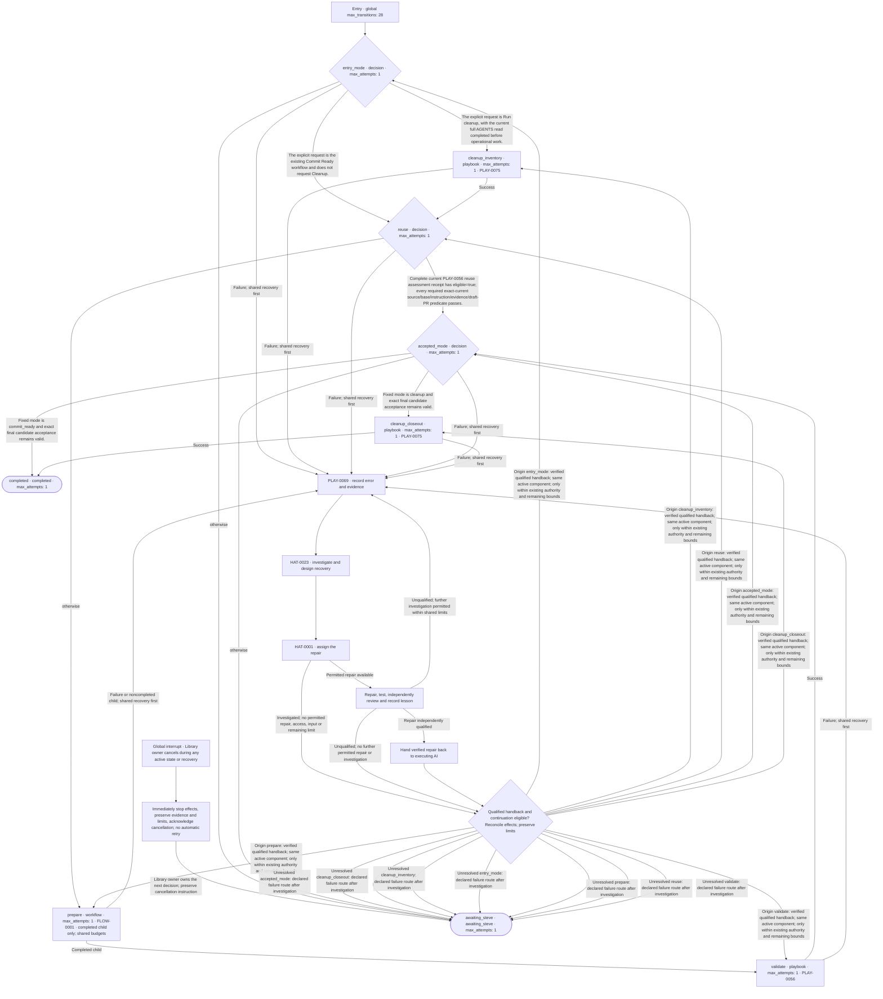

# Commit Ready

## Qualification

This definition requires destination-specific qualification. Source repository approval and evidence do not transfer. The draft grants no execution authority.

## Workflow contract

```workflow-json
{
  "schema_version": 1,
  "purpose": "Return exact candidate-ready staging and a pinned draft PR by verifying valid exact-current acceptance, or preparing source and executing qualified validation when required.",
  "trigger": "An explicit current-conversation request to run Commit Ready (FLOW-0002) after its exact independent approval and admission; source construction/approval is not invocation. Once this revised definition is independently approved and admitted, Run cleanup selects its cleanup mode; creating or reviewing Cleanup does not invoke it.",
  "scope": "the configured Library repository staging, current task-owned scratch and the required PLAY-0056 validation/reconciliation/draft-PR actions for one evidenced candidate scope.",
  "non_goals": [
    "PLAY-0055, merge, main mutation, external sends, deployment, new schedules, unrelated Actions, another candidate batch or wider work.",
    "Changing source-only FLOW-0001 into a candidate-validation workflow or treating a policy edit as operational invocation."
  ],
  "inputs": [
    "Exact current explicit workflow invocation, approved definition/dependencies/policies/resources, verified actual actor/access and permitted effects.",
    "Canonical owner/used plan, original source main/staging, current expected head, source change inputs, own scratch and existing partial effects.",
    "Original and proposed routing/benchmark/relationship/ID datasets, including .github/intent-routing.json and .github/evaluation/tick-0166-retrieval.json when used; snapshot exact run hashes and preserve existing assertions, apply the actual pinned validators and obtain required independent mutation acceptance. These are mutable candidate data, not frozen executable controls.",
    "Verify native hashes and actual helper results for owner-configured executable resources. Use only fixtures supplied by the destination repository.",
    "Current per-run external-route ledger: exact callable route/actor/access, trigger/ref/input and author-boundary obligations, observed run/status/artifact channels, supported alternatives and their availability evidence.",
    "Fixed operation_mode is commit_ready for the existing explicit Commit Ready request, or cleanup for the explicit Run cleanup request. Unknown/contradictory request scope fails; no new schedule or standing grant is created.",
    "Cleanup first reads current AGENTS.md in full even if previously read in the chat, before operational inventory, preparation, validation or deletion; record exact source revision/read receipt. Ordinary Commit Ready retains current context rules.",
    "Ordinary commit_ready retains its prior limit of 22 transitions. Cleanup has at most 28 shared transitions including child edges; no counter reset."
  ],
  "outputs": [
    "Verified source-preparation child result, exact candidate preparation/release evidence and final candidate-ready staging SHA.",
    "On completed success, one draft staging-to-main PR with final validated head/current main base and evidence; otherwise awaiting_steve with the precise evidenced human handoff and preserved effects.",
    "A newly accepted result with result_origin=executed, or the identical verified current accepted result with result_origin=reused. Reuse names original child/run evidence and fresh checks; it never claims those actions ran again.",
    "Cleanup mode only: actual preservation mapping, verified final validation receipt, exact deleted/retained/inaccessible inventory and coverage limits from PLAY-0075."
  ],
  "authority": "the Library owner explicit current request to run this already-approved workflow covers only its declared executable components under AGENTS rule6; record original request/scope/access at entry and inherit it without another PLAY-0056 exception prompt. Definition, review or source-policy creation grants no authority. Separate merge/main/send/deploy/schedule gates remain.",
  "completion": "Under either a new qualified child/PLAY-0056 execution or PLAY-0056 Exact-current accepted-result reuse, every required source/preparation/review/actual candidate-ready and current exact draft-PR predicate passes. Exact staging/main and current admission/authority/instruction baseline are verified; report result_origin and actual effects. Reuse creates no commit, trigger or validation run. For operation_mode=cleanup, the source inventory is reconciled and successful PLAY-0075 final exact-candidate deletion/remaining-inventory/report evidence is additionally mandatory. Intentional retained active work is reported; any unresolved capture, validation or required deletion gap prevents Cleanup completion.",
  "persistence": "Invoking canonical Ticket/Project and its used plan, or existing canonical subject owner; transient root/child run state stays outside reusable instructions.",
  "risks": [
    "Manual operator gates require actual per-run verification; source admission is not an installed action executor.",
    "Initial qualification uses representative controls/primitives and exact independent review; no whole successful FLOW-0002 run or scheduled branch is claimed before one occurs.",
    "Concurrent staging/main/access changes can stop the run. Candidate full preflight has broader instruction/resource scope than source preparation."
  ],
  "grill_me": "SKILL-0318",
  "entry": "entry_mode",
  "max_transitions": 28,
  "steps": [
    {
      "owner": "HAT-0001",
      "actor_access": "Actual operator with verified read access only to this phase's request, current Library policies/admission/candidate evidence, accessible chat and demonstrably task-owned local files. No source-write or trigger capability is required or exercised in this phase.",
      "prerequisites": [
        "Current explicit request and fresh admission for this revised definition; source creation/review is not invocation."
      ],
      "inputs": [
        "Exact original request; current policy source for Cleanup."
      ],
      "outputs": [
        "Fixed operation_mode plus Cleanup fresh-policy receipt when applicable."
      ],
      "allowed_effects": [
        "Instruction reads and mode selection only."
      ],
      "success_check": "Exactly one explicit request mode is established; Cleanup fresh full policy read is proved. Ambiguous/unknown request or inaccessible policy is failure. No approval/authority is inferred from creation or prior runs.",
      "recovery": "For entry_mode failure, apply this contract's failure_handling bindings and the existing active-phase continuation gate. Preserve effects and remaining shared limits; no terminal re-entry.",
      "max_attempts": 1,
      "controls": [
        {
          "requirement": "Apply PLAY-0075 entry and AGENTS authority; forbid all effects until the exact admitted mode is established.",
          "mode": "instruction",
          "evidence": "Original request, fresh full policy source/read evidence for Cleanup, actual admission receipt.",
          "critical": true
        }
      ],
      "id": "entry_mode",
      "kind": "decision",
      "playbook": "PLAY-0075",
      "scope": "Identify the explicit original request only. For a Cleanup request, first read current AGENTS.md in full as the first operational action; record source/read evidence before selecting cleanup_inventory. No operational inventory, source effect or validation precedes that read. Ordinary Commit Ready reuses its established context rules. After the mandatory fresh AGENTS read for Cleanup, apply Workflows/README.md Mandatory operating briefings opening briefing. For ordinary Commit Ready apply the opening briefing under existing context rules.",
      "failure": "awaiting_steve",
      "branches": [
        {
          "when": "The explicit request is Run cleanup, with the current full AGENTS read completed before operational work.",
          "to": "cleanup_inventory"
        },
        {
          "when": "The explicit request is the existing Commit Ready workflow and does not request Cleanup.",
          "to": "reuse"
        },
        {
          "when": "otherwise",
          "to": "awaiting_steve"
        }
      ]
    },
    {
      "owner": "HAT-0001",
      "actor_access": "Actual operator with verified read access only to this phase's request, current Library policies/admission/candidate evidence, accessible chat and demonstrably task-owned local files. No source-write or trigger capability is required or exercised in this phase.",
      "prerequisites": [
        "Fixed cleanup mode and fresh full AGENTS read proved by entry_mode; current admission, actor/access and original scope."
      ],
      "inputs": [
        "Accessible current chat and exact task-owned scratch/actions; existing canonical evidence."
      ],
      "outputs": [
        "Bounded coverage and exact inventory/disposition packet; explicit inaccessible sources and preserved gaps."
      ],
      "allowed_effects": [
        "Scoped reads and in-memory inventory only; no deletion/source write/trigger."
      ],
      "success_check": "Required accessible content is accounted for and required gaps are not represented as complete. Active writers/inputs are identified and retained. Packet is adequate for source reconciliation and reuse assessment.",
      "recovery": "For cleanup_inventory failure, apply this contract's failure_handling bindings and the existing active-phase continuation gate. Preserve effects and remaining shared limits; no terminal re-entry.",
      "max_attempts": 1,
      "controls": [
        {
          "requirement": "Inventory proof is not filing, validation or deletion proof; apply PLAY-0075 inventory_gate and shared failure handling.",
          "mode": "instruction",
          "evidence": "Source-anchored inventory, original request and fresh policy receipt.",
          "critical": true
        }
      ],
      "id": "cleanup_inventory",
      "kind": "playbook",
      "playbook": "PLAY-0075",
      "scope": "PLAY-0075 inventory_gate only. Use its fresh AGENTS receipt, reconcile accessible chat content and task-owned file/active-producer coverage; prepare the preservation/disposition map. Reuse PLAY-0059 inventory rules, with no source write, validation or deletion.",
      "uses": "PLAY-0075",
      "capabilities": [],
      "next": "reuse",
      "failure": "awaiting_steve"
    },
    {
      "owner": "HAT-0001",
      "actor_access": "Actual connected read-only operator with verified access to the exact scoped source/ref/admission/provenance/run/artifact/status/draft-PR evidence required by this state. Unused source-write/trigger capability is not required. No write or candidate route is exercised in this state.",
      "prerequisites": [
        "Current invocation and admission evidence satisfies this contract's trigger/authority and Playbooks/PLAY-0059-commit-ready.md, Manual FLOW operator gate, for reuse.",
        "Read capability for the exact scoped source inventory, refs, required acceptance/provenance, run/artifact/status and draft PR; apply the complete assessment/error rule in PLAY-0056 Exact-current accepted-result reuse."
      ],
      "inputs": [
        "Current scoped source inventory/capture proof; exact live staging/main and approved definition/dependency/policy/resource baseline; authoritative prior acceptance or complete authoritative absence/disqualification evidence; current matching PR data."
      ],
      "outputs": [
        "Fresh reuse assessment receipt: eligible=true/false and exact reasons, or explicit assessment failure; original acceptance/run/artifact/source pointers, fresh live-check results and actual effects."
      ],
      "allowed_effects": [
        "Read-only scoped assessment/return-packet preparation; no source/PR write, child run, trigger or validation execution."
      ],
      "success_check": "Use PLAY-0056 Exact-current accepted-result reuse as the complete eligibility predicate. Match eligible=true only after every required condition passes. A complete assessment proving eligible=false takes otherwise; missing current authority/admission, inaccessible/incomplete required reads or unresolved contradictions take failure/shared recovery, never otherwise. No arbitrary validity period or skipped governing fresh check.",
      "recovery": "For reuse failure, apply this contract's failure_handling bindings before its declared failure edge; evaluate the originating operation through failure_handling.continuation.",
      "max_attempts": 1,
      "controls": [
        {
          "requirement": "On entering reuse, apply Workflows/README.md, Mandatory operating briefings to this step's scope, prerequisites, inputs, allowed_effects, success_check and recovery.",
          "mode": "instruction",
          "evidence": "PLAY-0056 governing phase; this exact step contract and actual existing-run evidence/decision pointers. A read tick is not proof.",
          "critical": true
        },
        {
          "requirement": "For reuse, apply Playbooks/PLAY-0059-commit-ready.md, Manual FLOW operator gate, to this step's actual actor_access, prerequisites and intended effects.",
          "mode": "instruction",
          "evidence": "AGENTS rule6, SKILL-0188 and actual prospective per-run ledger; not installed runtime enforcement.",
          "critical": true
        },
        {
          "requirement": "Before reuse effects, apply Playbooks/PLAY-0059-commit-ready.md, Qualification evidence and planned-write preflight, to the exact intended effect footprint.",
          "mode": "instruction",
          "evidence": "PLAY-0059 manual operator gate and check_workflows.py --planned-write preflight; actual runtime source/OS boundary evidence required.",
          "critical": true
        },
        {
          "requirement": "For reuse, apply Playbooks/PLAY-0056-commit-library-work-to-staging.md, Required route assessment before a blocker or permission question, and Candidate trigger selection and recovery, to the proposed candidate route.",
          "mode": "instruction",
          "evidence": "PLAY-0056 Candidate trigger selection and recovery; SKILL-0313 external route qualification; actual prospective per-run route ledger and observed exact run/status/artifact.",
          "critical": true
        },
        {
          "requirement": "Apply Workflows/README.md, Minimum necessary execution contract, to reuse's declared operations, evidence, acceptance and any proposed additional work.",
          "mode": "instruction",
          "evidence": "This exact phase scope/input/output/success/recovery contract and actual run receipts; record a qualifying reason before extra work. Not automatic runtime enforcement.",
          "critical": true
        }
      ],
      "id": "reuse",
      "kind": "decision",
      "playbook": "PLAY-0056",
      "scope": "Apply the phase briefing in Workflows/README.md Mandatory operating briefings against this phase and current run evidence. PLAY-0056 Exact-current accepted-result reuse, read-only assessment only: verify the current request's finite durable source inventory, exact refs/admission/instruction baseline, required prior acceptance receipts and current candidate/run/artifact/status/draft-PR evidence. Use existing applicable source inventory/read receipts rather than duplicate child work. No commit, child execution, trigger, preparation/release rerun or PR mutation occurs in this state.",
      "failure": "awaiting_steve",
      "branches": [
        {
          "when": "Complete current PLAY-0056 reuse assessment receipt has eligible=true; every required exact-current source/base/instruction/evidence/draft-PR predicate passes.",
          "to": "accepted_mode"
        },
        {
          "when": "otherwise",
          "to": "prepare"
        }
      ]
    },
    {
      "owner": "HAT-0001",
      "actor_access": "Actual connected Library operator; verify callable candidate route under PLAY-0056 Candidate trigger selection and recovery, authenticated actor/access, guarded source writes, run/artifact/status and draft-PR visibility. Push access is not dispatch proof; no tool or permission is invented.",
      "prerequisites": [
        "Current invocation and admission evidence satisfies this contract's trigger/authority and Playbooks/PLAY-0059-commit-ready.md, Manual FLOW operator gate, for prepare.",
        "The current root/child run ledger satisfies Playbooks/PLAY-0059-commit-ready.md, Manual FLOW operator gate, and Approved parent invocation and return, for prepare.",
        "Before any child source effect, verify and record the actual callable candidate route, native trigger/input and correct author-boundary obligations, actor/access and readable run/status/artifact/PR channels under SKILL-0313 and PLAY-0056; unavailable indispensable route blocks child effects while independent discovery continues. Resolve actual candidate values only at validation entry.",
        "Run the read-only candidate_entry.py phase entry through SKILL-0186; require qualified_route_plan, anchored current checks and a supported post-child trigger/boundary strategy. Future parent may derive only from verified own child effects; required author_base provenance is not deferred or guessed.",
        "A complete current reuse assessment proved eligible=false; assessment failure cannot enter. In cleanup mode reserve four parent edges after child return, child allowance at most min(22, root remaining minus 4). In ordinary mode reserve three parent edges, child allowance at most min(20, root remaining minus 3). Child and parent share actual counters; no reset."
      ],
      "inputs": [
        "Current root request, admitted definition/dependencies, owning record/used plan and exact source/actor/access evidence.",
        "Required phase evidence: current authority/access/admission, original/current heads, route assessor receipt, actual child outputs/effects and remaining shared limits. Reuse existing applicable receipts after exact identity/freshness checks.",
        "Pass scratch_mode=defer_until_validated for fixed cleanup mode; source_closeout for ordinary commit_ready. Require child to echo unchanged mode."
      ],
      "outputs": [
        "Observed phase result, original/current baseline, preserved partial effects and remaining shared limits."
      ],
      "allowed_effects": [
        "Only the declared admitted step under the current explicit workflow-entry grant; staging source and required candidate validation/draft PR only; no merge/main writes/sends/deployment/new schedules."
      ],
      "success_check": "Child actually returns completed with required source readback, scratch disposition and handoff. Count its actual edges against this root limit; preserve its attempts/effects. A failed/cancelled/unapproved child cannot reach validate. Verify child original/current heads and only its exact own-save/allocator advances before candidate entry. Ordinary authorised new-Skill and routing/benchmark-data source footprints must preserve admission; planned-write acceptance does not waive required source validators or independent mutation review. Frozen instruction/control mutation still stops and routes outside the invocation. Apply Workflows/README.md, Minimum necessary execution contract, at acceptance. Cleanup requires child scratch_result=deferred with zero deletions and complete packet; ordinary requires its existing close-out evidence. A mode mismatch or early deletion is failure.",
      "recovery": "For prepare failure, apply this contract's failure_handling bindings before its declared failure edge; evaluate the originating operation through failure_handling.continuation.",
      "max_attempts": 1,
      "controls": [
        {
          "requirement": "On entering prepare, apply Workflows/README.md, Mandatory operating briefings to this step's scope, prerequisites, inputs, allowed_effects, success_check and recovery.",
          "mode": "instruction",
          "evidence": "PLAY-0059 governing phase; this exact step contract and actual existing-run evidence/decision pointers. A read tick is not proof.",
          "critical": true
        },
        {
          "requirement": "For prepare, apply Playbooks/PLAY-0059-commit-ready.md, Manual FLOW operator gate, to this step's actual actor_access, prerequisites and intended effects.",
          "mode": "instruction",
          "evidence": "AGENTS rule6, SKILL-0188 and actual prospective per-run ledger; not installed runtime enforcement.",
          "critical": true
        },
        {
          "requirement": "Before prepare effects, apply Playbooks/PLAY-0059-commit-ready.md, Qualification evidence and planned-write preflight, to the exact intended effect footprint.",
          "mode": "instruction",
          "evidence": "PLAY-0059 manual operator gate and check_workflows.py --planned-write preflight; actual runtime source/OS boundary evidence required.",
          "critical": true
        },
        {
          "requirement": "For prepare, apply Playbooks/PLAY-0056-commit-library-work-to-staging.md, Required route assessment before a blocker or permission question, and Candidate trigger selection and recovery, to the proposed candidate route.",
          "mode": "instruction",
          "evidence": "PLAY-0056 Candidate trigger selection and recovery; SKILL-0313 external route qualification; actual prospective per-run route ledger and observed exact run/status/artifact.",
          "critical": true
        },
        {
          "requirement": "Apply Workflows/README.md, Minimum necessary execution contract, to prepare's declared operations, evidence, acceptance and any proposed additional work.",
          "mode": "instruction",
          "evidence": "This exact phase scope/input/output/success/recovery contract and actual run receipts; record a qualifying reason before extra work. Not automatic runtime enforcement.",
          "critical": true
        }
      ],
      "id": "prepare",
      "kind": "workflow",
      "playbook": "PLAY-0059",
      "scope": "Invoke source-preparation child FLOW-0001 only; share root transition allowance and carry actual original/current heads and partial effects. Permitted operations only: verify current entry gates and supported candidate route; call only the declared source-preparation child once; verify its completed return and proved own source advances. Excluded: unrelated work and any optional operation/effect outside this phase.",
      "uses": "FLOW-0001",
      "capabilities": [],
      "next": "validate",
      "failure": "awaiting_steve",
      "return_policy": "completed_only",
      "budget_policy": "shared"
    },
    {
      "owner": "HAT-0001",
      "actor_access": "Actual connected Library operator; verify callable candidate route under PLAY-0056 Candidate trigger selection and recovery, authenticated actor/access, guarded source writes, run/artifact/status and draft-PR visibility. Push access is not dispatch proof; no tool or permission is invented.",
      "prerequisites": [
        "Current invocation and admission evidence satisfies this contract's trigger/authority and Playbooks/PLAY-0059-commit-ready.md, Manual FLOW operator gate, for validate.",
        "The current root/child run ledger satisfies Playbooks/PLAY-0059-commit-ready.md, Manual FLOW operator gate, and Approved parent invocation and return, for validate.",
        "Child completed, exact outputs/effects verified; original main unchanged and current staging equals the proved child result. Resolve the candidate boundary now; unrelated or unproved movement stops rather than adopting another batch.",
        "Recheck selected route with actual candidate_sha, main and correct author_base. Conditional marked substantive-source or explicitly qualified validation-request push must use the exact required author boundary through its strict Candidate-Author-Base trailer, or prove event.before already equals that boundary; never use source-only child save or noise/history rewrite as trigger.",
        "Run candidate_entry.py phase validate with exact current staging, actual correct author_base and prepared new sole-parent commit for push or current-head candidate for dispatch; require eligible_for_authorised_attempt before the operational effect, then independently prove actual triggering/results."
      ],
      "inputs": [
        "Current root request, admitted definition/dependencies, owning record/used plan and exact source/actor/access evidence.",
        "Required phase evidence: actual current candidate/main/author boundary, route/child/source receipts, complete preparation/release and exact final status/artifact/ancestry/draft-PR evidence. Reuse existing applicable receipts after exact identity/freshness checks."
      ],
      "outputs": [
        "Observed phase result, original/current baseline, preserved partial effects and remaining shared limits."
      ],
      "allowed_effects": [
        "Only the declared admitted step under the current explicit workflow-entry grant; staging source and required candidate validation/draft PR only; no merge/main writes/sends/deployment/new schedules.",
        "After verified child completion only, one fully qualified PLAY-0056 validation-request control commit over the exact corrected current source tree under the same current operational grant; it is not a source correction or another candidate batch."
      ],
      "success_check": "All PLAY-0056 exact preparation/required release preflight, learning receipt, independent review, successful exact-head candidate-ready and draft PR checks pass. Candidate repair satisfies Playbooks/PLAY-0056-commit-library-work-to-staging.md, Bounded repair continuation, under AGENTS.md Library rule 6. A workflow-proven generated-only reconciliation for the pinned source may continue under PLAY-0056; unrelated movement/changed main stops. Verify exact observed trigger/event/source SHA and executed candidate job before final candidate-ready; skipped/no-run/stale or wrong-head evidence is failure, never acceptance. Prior-failure history must be complete and authoritative; native finite GET transport recovery before this gate returns is not an unchanged candidate replay. Exhausted/unverified history yields no absence verdict. Later retrieval success cannot replace skipped preparation, learning or attestation. Apply Workflows/README.md, Minimum necessary execution contract, at acceptance.",
      "recovery": "For validate failure, apply this contract's failure_handling bindings before its declared failure edge; evaluate the originating operation through failure_handling.continuation.",
      "max_attempts": 1,
      "controls": [
        {
          "requirement": "On entering validate, apply Workflows/README.md, Mandatory operating briefings to this step's scope, prerequisites, inputs, allowed_effects, success_check and recovery.",
          "mode": "instruction",
          "evidence": "PLAY-0056 governing phase; this exact step contract and actual existing-run evidence/decision pointers. A read tick is not proof.",
          "critical": true
        },
        {
          "requirement": "For validate, apply Playbooks/PLAY-0059-commit-ready.md, Manual FLOW operator gate, to this step's actual actor_access, prerequisites and intended effects.",
          "mode": "instruction",
          "evidence": "AGENTS rule6, SKILL-0188 and actual prospective per-run ledger; not installed runtime enforcement.",
          "critical": true
        },
        {
          "requirement": "Before validate effects, apply Playbooks/PLAY-0059-commit-ready.md, Qualification evidence and planned-write preflight, to the exact intended effect footprint.",
          "mode": "instruction",
          "evidence": "PLAY-0059 manual operator gate and check_workflows.py --planned-write preflight; actual runtime source/OS boundary evidence required.",
          "critical": true
        },
        {
          "requirement": "Apply Workflows/README.md, Minimum necessary execution contract, to validate's declared operations, evidence, acceptance and any proposed additional work.",
          "mode": "instruction",
          "evidence": "This exact phase scope/input/output/success/recovery contract and actual run receipts; record a qualifying reason before extra work. Not automatic runtime enforcement.",
          "critical": true
        }
      ],
      "id": "validate",
      "kind": "playbook",
      "playbook": "PLAY-0056",
      "scope": "Invoke the complete PLAY-0056 candidate preparation/changed-input recovery/final exact-head candidate-ready and draft-PR procedure, once for its resolved pinned candidate. Permitted operations only: verify the current route, author boundary and complete prior-failure evidence; run the required complete exact source preparation and release preflight, learning, independent source review and attestation gates; prepare and publish one qualified native trigger; wait for its result under the declared polling interval/request/deadline bounds; verify exact final status, artifact, unchanged main and permitted reconciliation ancestry; create or reuse the required draft PR and verify its head/base/draft state; repair only a diagnosed authorised changed input within the shared cumulative cap and repeat every required exact-candidate gate. Excluded: unrelated work and any optional operation/effect outside this phase.",
      "uses": "PLAY-0056",
      "capabilities": [],
      "next": "accepted_mode",
      "failure": "awaiting_steve"
    },
    {
      "owner": "HAT-0001",
      "actor_access": "Actual operator with verified read access only to this phase's request, current Library policies/admission/candidate evidence, accessible chat and demonstrably task-owned local files. No source-write or trigger capability is required or exercised in this phase.",
      "prerequisites": [
        "Verified final exact-current acceptance from reuse or validate; original scope and remaining shared limits unchanged."
      ],
      "inputs": [
        "Fixed operation_mode; final source/base/status/artifact/draft-PR evidence and preservation mapping."
      ],
      "outputs": [
        "Final Cleanup close-out route or ordinary completion route."
      ],
      "allowed_effects": [
        "Instruction reads and mode selection only."
      ],
      "success_check": "cleanup selects cleanup_closeout; commit_ready selects completed. Unknown mode, stale acceptance or source/mapping change follows failure.",
      "recovery": "For accepted_mode failure, apply this contract's failure_handling bindings and the existing active-phase continuation gate. Preserve effects and remaining shared limits; no terminal re-entry.",
      "max_attempts": 1,
      "controls": [
        {
          "requirement": "Apply PLAY-0075 entry and AGENTS authority; forbid all effects until the exact admitted mode is established.",
          "mode": "instruction",
          "evidence": "Original request, fresh full policy source/read evidence for Cleanup, actual admission receipt.",
          "critical": true
        }
      ],
      "id": "accepted_mode",
      "kind": "decision",
      "playbook": "PLAY-0075",
      "scope": "Select final close-out from the fixed operation_mode after actual candidate acceptance or permitted exact-current reuse. Read-only; never reclassify a failed/unknown validation as acceptance.",
      "failure": "awaiting_steve",
      "branches": [
        {
          "when": "Fixed mode is cleanup and exact final candidate acceptance remains valid.",
          "to": "cleanup_closeout"
        },
        {
          "when": "Fixed mode is commit_ready and exact final candidate acceptance remains valid.",
          "to": "completed"
        },
        {
          "when": "otherwise",
          "to": "awaiting_steve"
        }
      ]
    },
    {
      "owner": "HAT-0001",
      "actor_access": "Actual operator with verified read access to exact accepted candidate/preservation evidence and filesystem inspection/deletion access to individually proven task-owned scratch files. Candidate trigger, source-write and PR-write capabilities are not required or exercised. Inaccessible files remain reported and undeleted.",
      "prerequisites": [
        "Fixed cleanup mode; every required source/capture gate passed; final authoritative successful validation or valid exact-current reuse; exact current heads/definition/preservation mapping still match; no cancellation or exhausted limits."
      ],
      "inputs": [
        "Final accepted candidate evidence; complete deferred packet (or inventory packet on reuse); exact current scratch including validation-created files and producer state."
      ],
      "outputs": [
        "Actual removed files, justified retained paths, inaccessible/failed items, final remaining inventory and truthful Cleanup report."
      ],
      "allowed_effects": [
        "Individually verified task-owned scratch deletions only, preferably recoverable; no canonical write, repository/user-original deletion, broad recursive deletion, symlink/junction traversal, merge or new trigger."
      ],
      "success_check": "PLAY-0075 deletion gates pass for each removal and remaining inventory matches actual effects. New/changed content is retained, required capture/validation gaps block all deletion; partial deletion errors are reported as incomplete. Any candidate/preservation mapping change invalidates use of the prior pass. Zero eligible files is a verified no-op.",
      "recovery": "For cleanup_closeout failure, apply this contract's failure_handling bindings and the existing active-phase continuation gate. Preserve effects and remaining shared limits; no terminal re-entry.",
      "max_attempts": 1,
      "controls": [
        {
          "requirement": "No scratch deletion until final candidate acceptance and coverage/identity proof; preserve required active/unique/unfinished evidence and reject symlinks/junctions.",
          "mode": "instruction",
          "evidence": "PLAY-0075, SKILL-0319 and exact per-file readback/effect/remaining-inventory observations.",
          "critical": true
        }
      ],
      "id": "cleanup_closeout",
      "kind": "playbook",
      "playbook": "PLAY-0075",
      "scope": "PLAY-0075 deletion_gate_and_closeout and report only. Verify final validated candidate and complete preservation mapping, recheck exact file identity/ownership/path/no-active-use, delete only the unchanged allowlist, then verify remaining inventory and return actual results.",
      "uses": "PLAY-0075",
      "capabilities": [],
      "next": "completed",
      "failure": "awaiting_steve"
    },
    {
      "owner": "HAT-0001",
      "actor_access": "Actual connected read-only operator with verified access to the exact scoped source/ref/admission/provenance/run/artifact/status/draft-PR evidence required by this state. Unused source-write/trigger capability is not required. No write or candidate route is exercised in this state.",
      "prerequisites": [
        "Current invocation and admission evidence satisfies this contract's trigger/authority and Playbooks/PLAY-0059-commit-ready.md, Manual FLOW operator gate, for completed.",
        "The current root/child run ledger satisfies Playbooks/PLAY-0059-commit-ready.md, Manual FLOW operator gate, and Approved parent invocation and return, for completed."
      ],
      "inputs": [
        "Qualified executed result receipts or eligible=true reuse assessment with original acceptance pointers; fresh exact staging/main/admission/status/draft-PR evidence and actual effects/shared remaining limits."
      ],
      "outputs": [
        "Accepted final staging SHA, verified draft PR URL/head/base/open/draft state, preparation/run/artifact/review evidence pointers, result_origin and actual effects; no invented execution."
      ],
      "allowed_effects": [
        "Read-only verification of existing acceptance/current-live-check receipts and immediate return; no source/PR writes, new trigger, validation or other operational effects."
      ],
      "success_check": "The exact accepted final head equals current staging; original accepted base equals current main; current approved instruction/admission and applicable source/preparation/review/run/artifact/candidate-ready receipts meet PLAY-0056 and SKILL-0186; fresh PR verification proves the matching open draft/head/base. For reuse, every reuse predicate passed and no new run/write is claimed; for executed, actual required child/run result exists. Apply Workflows/README.md, Minimum necessary execution contract, to this accepted result return. Cleanup mode additionally requires actual cleanup_closeout completion and report; reuse acceptance alone cannot skip it.",
      "recovery": "Apply Playbooks/PLAY-0059-commit-ready.md, Manual FLOW operator gate, terminal-completion/fresh-entry boundary, to this verified result.",
      "max_attempts": 1,
      "controls": [
        {
          "requirement": "On entering completed, apply Workflows/README.md, Mandatory operating briefings, terminal and cancellation provisions, to this terminal's actual evidence and outcome.",
          "mode": "instruction",
          "evidence": "PLAY-0056 governing phase; this exact step contract and actual existing-run evidence/decision pointers. A read tick is not proof.",
          "critical": true
        },
        {
          "requirement": "For completed, apply Playbooks/PLAY-0059-commit-ready.md, Manual FLOW operator gate, to this step's actual actor_access, prerequisites and intended effects.",
          "mode": "instruction",
          "evidence": "AGENTS rule6, SKILL-0188 and actual prospective per-run ledger; not installed runtime enforcement.",
          "critical": true
        },
        {
          "requirement": "Before completed effects, apply Playbooks/PLAY-0059-commit-ready.md, Qualification evidence and planned-write preflight, to the exact intended effect footprint.",
          "mode": "instruction",
          "evidence": "PLAY-0059 manual operator gate and check_workflows.py --planned-write preflight; actual runtime source/OS boundary evidence required.",
          "critical": true
        }
      ],
      "id": "completed",
      "kind": "terminal",
      "playbook": "PLAY-0056",
      "scope": "Read-only final receipt verification and result return for either executed or reused acceptance. No source, child, trigger, candidate or PR mutation may start here.",
      "outcome": "completed"
    },
    {
      "owner": "HAT-0001",
      "actor_access": "Apply Playbooks/PLAY-0069-workflow-qualification-and-recovery.md, Two-outcome service contract, to the available read-only operator for this source/run packet.",
      "prerequisites": [
        "An actual failure, missing input/decision or cancellation packet under Playbooks/PLAY-0069-workflow-qualification-and-recovery.md, Two-outcome service contract; apply its reporting prerequisites.",
        "Human-handoff eligibility or cancellation acknowledgement is determined by Playbooks/PLAY-0069-workflow-qualification-and-recovery.md, Two-outcome service contract."
      ],
      "inputs": [
        "Available source/run evidence, exact known/uncertain effects, repair/handback history and remaining limits."
      ],
      "outputs": [
        "This FLOW's actual handoff packet, with the fields declared below, satisfying Playbooks/PLAY-0069-workflow-qualification-and-recovery.md, Two-outcome service contract."
      ],
      "allowed_effects": [
        "Only read-only reporting of this packet under Playbooks/PLAY-0069-workflow-qualification-and-recovery.md, Two-outcome service contract."
      ],
      "success_check": "The actual source/run evidence and populated handoff fields satisfy Playbooks/PLAY-0069-workflow-qualification-and-recovery.md, Two-outcome service contract, for the observed unresolved outcome or cancellation instruction.",
      "recovery": "Apply Playbooks/PLAY-0069-workflow-qualification-and-recovery.md, Two-outcome service contract, to this stopped-attempt packet and any proposed future entry.",
      "max_attempts": 1,
      "controls": [
        {
          "requirement": "On entering awaiting_steve, apply Workflows/README.md, Mandatory operating briefings, terminal and cancellation provisions, to this terminal's actual evidence and outcome.",
          "mode": "instruction",
          "evidence": "PLAY-0069 governing phase; this exact step contract and actual existing-run evidence/decision pointers. A read tick is not proof.",
          "critical": true
        },
        {
          "requirement": "Apply Playbooks/PLAY-0069-workflow-qualification-and-recovery.md, Two-outcome service contract, to this read-only root handoff; use its immediate cancellation and unavailable-access provisions.",
          "mode": "instruction",
          "evidence": "PLAY-0059 refusal terminal and PLAY-0069 read-only failure report; independent blocked-gate review required.",
          "critical": true
        }
      ],
      "id": "awaiting_steve",
      "kind": "terminal",
      "playbook": "PLAY-0069",
      "scope": "Read-only result reporting for this FLOW's unresolved source/run outcome under Playbooks/PLAY-0069-workflow-qualification-and-recovery.md, Two-outcome service contract; this terminal's inputs and handoff fields identify the packet.",
      "outcome": "awaiting_steve",
      "handoff": {
        "question": "Apply Playbooks/PLAY-0069-workflow-qualification-and-recovery.md, Two-outcome service contract, to this run's actual remaining the Library owner-owned need or cancellation acknowledgement.",
        "why_needed": "Apply Playbooks/PLAY-0069-workflow-qualification-and-recovery.md, Two-outcome service contract, to the actual blocked source/run dependency and evidence of why accessible sources cannot settle it.",
        "investigated_options": "Apply Playbooks/PLAY-0069-workflow-qualification-and-recovery.md, Two-outcome service contract, to this occurrence's investigation, assigned work, alternatives, repair/review/handback results and applicable cancellation evidence.",
        "recommendation": "Apply Playbooks/PLAY-0069-workflow-qualification-and-recovery.md, Two-outcome service contract, to the smallest evidenced next choice for this source/run outcome and its effect.",
        "owner": "Library owner",
        "preserved_effects": "Apply Playbooks/PLAY-0069-workflow-qualification-and-recovery.md, Two-outcome service contract, to this run's canonical work/defect owner, executing AI, exact source/run identity, known or uncertain effects and retained evidence.",
        "remaining_limits": "Apply Playbooks/PLAY-0069-workflow-qualification-and-recovery.md, Two-outcome service contract, to this run's actual used and remaining request, phase, transition, recovery-controller and candidate-repair limits.",
        "next_entry": "Apply Playbooks/PLAY-0069-workflow-qualification-and-recovery.md, Two-outcome service contract, to the actual required answer/state change and applicable current entry gates for the proposed next effect.",
        "cancellation": "Apply Playbooks/PLAY-0069-workflow-qualification-and-recovery.md, Two-outcome service contract, to the actual cancellation instruction and acknowledgement, when present."
      }
    }
  ],
  "coverage": {
    "PLAY-0059": [
      {
        "requirement": "Source authority and stable target; reject stale/concurrent work",
        "steps": [
          "prepare"
        ],
        "skills": [
          "SKILL-0183",
          "SKILL-0184",
          "SKILL-0185",
          "SKILL-0186",
          "SKILL-0187",
          "SKILL-0188"
        ],
        "status": "gap",
        "evidence": null
      },
      {
        "requirement": "Complete source inventory, metadata, allocation, companions and reciprocal links",
        "steps": [
          "prepare"
        ],
        "skills": [
          "SKILL-0023",
          "SKILL-0024",
          "SKILL-0025",
          "SKILL-0026"
        ],
        "status": "gap",
        "evidence": null
      },
      {
        "requirement": "Authority-aware route and terminal evidence",
        "steps": [
          "prepare"
        ],
        "skills": [
          "SKILL-0188",
          "SKILL-0012"
        ],
        "status": "gap",
        "evidence": null
      },
      {
        "requirement": "Ownership-safe scratch disposition and remaining-inventory proof",
        "steps": [
          "prepare"
        ],
        "skills": [
          "SKILL-0319",
          "SKILL-0187"
        ],
        "status": "gap",
        "evidence": null
      },
      {
        "requirement": "Exact continuation packet preserves evidence, limits and retained inputs",
        "steps": [
          "prepare"
        ],
        "skills": [
          "SKILL-0012"
        ],
        "status": "gap",
        "evidence": null
      },
      {
        "requirement": "Complete current capability/referent assembly and confirmed Library relationship interpretation",
        "steps": [
          "prepare"
        ],
        "skills": [
          "SKILL-0113",
          "SKILL-0114"
        ],
        "status": "gap",
        "evidence": null
      },
      {
        "requirement": "Pre-effect candidate-route plan and read-only supported-recovery handoff, preserving source-only child boundaries.",
        "steps": [
          "prepare"
        ],
        "skills": [
          "SKILL-0186",
          "SKILL-0188"
        ],
        "status": "gap",
        "evidence": null
      },
      {
        "requirement": "Application of Workflows/README.md, Minimum necessary execution contract, to the mapped steps.",
        "steps": [
          "prepare"
        ],
        "skills": [
          "SKILL-0113",
          "SKILL-0187",
          "SKILL-0188"
        ],
        "status": "gap",
        "evidence": null
      },
      {
        "requirement": "Apply current operational-packet evidence at phase boundaries and handoff; verify interactive writes under SKILL-0187 without backfilling successful phases or reviving terminal authority.",
        "steps": [
          "prepare"
        ],
        "skills": [
          "SKILL-0187",
          "SKILL-0188"
        ],
        "status": "gap",
        "evidence": null
      }
    ],
    "PLAY-0041": [
      {
        "requirement": "Classify batch learning; preserve purpose; reuse/amend/create one canonical method, test independently and do not expand authority.",
        "steps": [
          "prepare"
        ],
        "skills": [
          "SKILL-0030",
          "SKILL-0113",
          "SKILL-0117",
          "SKILL-0118",
          "SKILL-0193",
          "SKILL-0194",
          "SKILL-0196",
          "SKILL-0197"
        ],
        "status": "gap",
        "evidence": null
      }
    ],
    "PLAY-0019": [
      {
        "requirement": "Select proportionate source checks, perform object readback and distinguish source proof from operational acceptance",
        "steps": [
          "prepare"
        ],
        "skills": [
          "SKILL-0008",
          "SKILL-0187",
          "SKILL-0117"
        ],
        "status": "gap",
        "evidence": null
      }
    ],
    "PLAY-0042": [
      {
        "requirement": "Verify consequential Library source/evidence claims; scope stays current batch; no domain-system mutation",
        "steps": [
          "prepare"
        ],
        "skills": [
          "SKILL-0114",
          "SKILL-0117",
          "SKILL-0187"
        ],
        "status": "gap",
        "evidence": null
      }
    ],
    "PLAY-0037": [
      {
        "requirement": "Only current-task residue; exact-file ownership/evidence-preserving closeout",
        "steps": [
          "prepare"
        ],
        "skills": [
          "SKILL-0319",
          "SKILL-0188"
        ],
        "status": "gap",
        "evidence": null
      }
    ],
    "PLAY-0049": [
      {
        "requirement": "Proportionate usable plan when needed; no extra outcome or forced companion",
        "steps": [
          "prepare"
        ],
        "skills": [
          "SKILL-0029"
        ],
        "status": "gap",
        "evidence": null
      }
    ],
    "PLAY-0050": [
      {
        "requirement": "Preserve existing inline/companion work history, evidence and parent authority while recording meaningful checkpoint",
        "steps": [
          "prepare"
        ],
        "skills": [
          "SKILL-0189",
          "SKILL-0190"
        ],
        "status": "gap",
        "evidence": null
      }
    ],
    "PLAY-0056": [
      {
        "requirement": "Source authority, stable batch and guarded write/readback",
        "steps": [
          "validate",
          "completed"
        ],
        "skills": [
          "SKILL-0183",
          "SKILL-0184",
          "SKILL-0185",
          "SKILL-0187",
          "SKILL-0188"
        ],
        "status": "gap",
        "evidence": null
      },
      {
        "requirement": "Complete source assembly, anchored deterministic repair, identities, metadata, links",
        "steps": [
          "validate",
          "completed"
        ],
        "skills": [
          "SKILL-0022",
          "SKILL-0023",
          "SKILL-0024",
          "SKILL-0025",
          "SKILL-0026"
        ],
        "status": "gap",
        "evidence": null
      },
      {
        "requirement": "Exact preparation/classifier/reconciliation/readiness",
        "steps": [
          "validate",
          "completed"
        ],
        "skills": [
          "SKILL-0027",
          "SKILL-0186",
          "SKILL-0187"
        ],
        "status": "gap",
        "evidence": null
      },
      {
        "requirement": "Failed-candidate diagnosis and exact learning receipt",
        "steps": [
          "validate",
          "completed"
        ],
        "skills": [
          "SKILL-0030",
          "SKILL-0199"
        ],
        "status": "gap",
        "evidence": null
      },
      {
        "requirement": "Independent current-diff code review and acceptance evidence",
        "steps": [
          "validate",
          "completed"
        ],
        "skills": [
          "SKILL-0117",
          "SKILL-0008"
        ],
        "status": "gap",
        "evidence": null
      },
      {
        "requirement": "Draft staging-to-main PR creation/reuse and exact head/currentbase verification",
        "steps": [
          "validate",
          "completed"
        ],
        "skills": [
          "SKILL-0186"
        ],
        "status": "gap",
        "evidence": null
      },
      {
        "requirement": "Executable candidate trigger and correct boundary, exact observed event/source/final result, and evidence-backed supported-alternative investigation before exhaustion.",
        "steps": [
          "validate"
        ],
        "skills": [
          "SKILL-0186",
          "SKILL-0188"
        ],
        "status": "gap",
        "evidence": null
      },
      {
        "requirement": "Select the verified environment-specific dispatch/substantive-source/validation-request route without product-name assumptions; for validation_request prove corrected source, complete first-request/failed-tree/receipt evidence, exact unchanged tree and sole parent, child completion, boundary/message and common candidate acceptance.",
        "steps": [
          "validate",
          "completed"
        ],
        "skills": [
          "SKILL-0186"
        ],
        "status": "gap",
        "evidence": null
      },
      {
        "requirement": "Application of Workflows/README.md, Minimum necessary execution contract, to the mapped steps.",
        "steps": [
          "validate",
          "completed"
        ],
        "skills": [
          "SKILL-0117",
          "SKILL-0187",
          "SKILL-0188"
        ],
        "status": "gap",
        "evidence": null
      },
      {
        "requirement": "Read-only exact-current accepted-result reuse versus complete proven disqualification or assessment failure; exact read-only completion receipt and no unused write/trigger capability.",
        "steps": [
          "reuse",
          "completed"
        ],
        "skills": [
          "SKILL-0186"
        ],
        "status": "gap",
        "evidence": null
      },
      {
        "requirement": "Recover only the authorised PR-description effect after missing form delivery; preserve required approvals, exact candidate evidence and single-addition readback, without duplicate validation or premature Cleanup completion.",
        "steps": [
          "validate",
          "completed"
        ],
        "skills": [
          "SKILL-0187",
          "SKILL-0188"
        ],
        "status": "gap",
        "evidence": null
      }
    ],
    "PLAY-0015": [
      {
        "requirement": "In-scope native/config deterministic repair, minimal diff and falsifying regression checks",
        "steps": [
          "validate"
        ],
        "skills": [
          "SKILL-0007",
          "SKILL-0008"
        ],
        "status": "gap",
        "evidence": null
      }
    ],
    "PLAY-0024": [
      {
        "requirement": "Review AI-authored change against evidence/criteria and resolve factual instruction drift",
        "steps": [
          "validate"
        ],
        "skills": [
          "SKILL-0117",
          "SKILL-0318"
        ],
        "status": "gap",
        "evidence": null
      }
    ],
    "PLAY-0069": [
      {
        "requirement": "Every failure uses tracked Director-to-Head repair, canonical lesson, verified executing-AI handback and observed permitted result before final human handoff; exactly completed or awaiting_steve service outcomes.",
        "steps": [
          "prepare",
          "validate",
          "completed",
          "awaiting_steve"
        ],
        "skills": [
          "SKILL-0313"
        ],
        "status": "gap",
        "evidence": null
      },
      {
        "requirement": "Application of Workflows/README.md, Minimum necessary execution contract, to the mapped steps.",
        "steps": [
          "prepare",
          "validate",
          "completed",
          "awaiting_steve"
        ],
        "skills": [
          "SKILL-0313"
        ],
        "status": "gap",
        "evidence": null
      },
      {
        "requirement": "Qualified same-active-attempt continuation at the exact incomplete operation, not second phase entry or terminal revival; preserve effects/counters and explicit failure/handoff boundaries.",
        "steps": [
          "reuse",
          "prepare",
          "validate",
          "completed",
          "awaiting_steve"
        ],
        "skills": [
          "SKILL-0313"
        ],
        "status": "gap",
        "evidence": null
      }
    ],
    "PLAY-0075": [
      {
        "requirement": "Cleanup fresh-policy entry, finite coverage inventory, final-acceptance mode guard, identity-safe deletion and actual report.",
        "steps": [
          "entry_mode",
          "cleanup_inventory",
          "accepted_mode",
          "cleanup_closeout"
        ],
        "skills": [
          "SKILL-0319"
        ],
        "status": "gap",
        "evidence": null
      },
      {
        "requirement": "Apply the owning packet and PR-transport recovery contracts after successful validation; missing required PR evidence cannot release scratch or satisfy Cleanup completion.",
        "steps": [
          "cleanup_inventory",
          "accepted_mode",
          "cleanup_closeout"
        ],
        "skills": [
          "SKILL-0319"
        ],
        "status": "gap",
        "evidence": null
      }
    ],
    "PLAY-0071": [
      {
        "requirement": "Mandatory confirmed-then-contextual link review during Cleanup source preparation, using verified evidence and reciprocal endpoints.",
        "steps": [
          "cleanup_inventory"
        ],
        "skills": [
          "SKILL-0025"
        ],
        "status": "gap",
        "evidence": null
      }
    ]
  },
  "dependencies": {
    "HAT-0001": [
      "PLAY-0041",
      "SKILL-0113",
      "SKILL-0114"
    ],
    "HAT-0006": [
      "PLAY-0019"
    ],
    "HAT-0007": [
      "PLAY-0019",
      "SKILL-0117"
    ],
    "HAT-0008": [],
    "HAT-0010": [
      "PLAY-0037"
    ],
    "PLAY-0019": [
      "SKILL-0008",
      "SKILL-0117",
      "SKILL-0187"
    ],
    "PLAY-0037": [
      "SKILL-0188",
      "SKILL-0319"
    ],
    "PLAY-0041": [
      "HAT-0007",
      "PLAY-0042",
      "SKILL-0030",
      "SKILL-0113",
      "SKILL-0117",
      "SKILL-0118",
      "SKILL-0193",
      "SKILL-0194",
      "SKILL-0196",
      "SKILL-0197"
    ],
    "PLAY-0042": [
      "SKILL-0114",
      "SKILL-0117",
      "SKILL-0187"
    ],
    "PLAY-0049": [
      "SKILL-0029"
    ],
    "PLAY-0050": [
      "SKILL-0189",
      "SKILL-0190"
    ],
    "PLAY-0059": [
      "PLAY-0019",
      "PLAY-0037",
      "PLAY-0041",
      "SKILL-0012",
      "SKILL-0023",
      "SKILL-0024",
      "SKILL-0025",
      "SKILL-0026",
      "SKILL-0113",
      "SKILL-0114",
      "SKILL-0183",
      "SKILL-0184",
      "SKILL-0185",
      "SKILL-0186",
      "SKILL-0187",
      "SKILL-0188",
      "SKILL-0319"
    ],
    "SKILL-0008": [],
    "SKILL-0012": [],
    "SKILL-0023": [],
    "SKILL-0024": [],
    "SKILL-0025": [
      "SKILL-0114",
      "SKILL-0176",
      "SKILL-0178",
      "SKILL-0179",
      "SKILL-0180",
      "SKILL-0181",
      "SKILL-0182"
    ],
    "SKILL-0026": [
      "PLAY-0049",
      "PLAY-0050"
    ],
    "SKILL-0029": [
      "SKILL-0189",
      "SKILL-0190"
    ],
    "SKILL-0030": [],
    "SKILL-0113": [
      "SKILL-0197",
      "SKILL-0318"
    ],
    "SKILL-0114": [],
    "SKILL-0117": [],
    "SKILL-0118": [
      "SKILL-0197"
    ],
    "SKILL-0176": [],
    "SKILL-0178": [],
    "SKILL-0179": [],
    "SKILL-0180": [],
    "SKILL-0181": [],
    "SKILL-0182": [],
    "SKILL-0183": [],
    "SKILL-0184": [],
    "SKILL-0185": [],
    "SKILL-0186": [],
    "SKILL-0187": [],
    "SKILL-0188": [],
    "SKILL-0189": [],
    "SKILL-0190": [],
    "SKILL-0193": [],
    "SKILL-0194": [],
    "SKILL-0196": [],
    "SKILL-0197": [
      "SKILL-0024"
    ],
    "SKILL-0318": [
      "SKILL-0113"
    ],
    "SKILL-0319": [],
    "FLOW-0001": [
      "HAT-0001",
      "HAT-0006",
      "HAT-0008",
      "HAT-0010",
      "HAT-0023",
      "PLAY-0041",
      "PLAY-0059",
      "PLAY-0069",
      "SKILL-0318"
    ],
    "PLAY-0056": [
      "HAT-0004",
      "HAT-0015",
      "PLAY-0019",
      "PLAY-0041",
      "SKILL-0008",
      "SKILL-0022",
      "SKILL-0023",
      "SKILL-0024",
      "SKILL-0025",
      "SKILL-0026",
      "SKILL-0027",
      "SKILL-0030",
      "SKILL-0117",
      "SKILL-0183",
      "SKILL-0184",
      "SKILL-0185",
      "SKILL-0186",
      "SKILL-0187",
      "SKILL-0188",
      "SKILL-0199"
    ],
    "HAT-0004": [
      "PLAY-0015",
      "HAT-0015"
    ],
    "HAT-0015": [
      "PLAY-0019",
      "PLAY-0024",
      "SKILL-0117"
    ],
    "PLAY-0015": [
      "PLAY-0019",
      "HAT-0015",
      "SKILL-0007",
      "SKILL-0008"
    ],
    "PLAY-0024": [
      "SKILL-0117",
      "SKILL-0318"
    ],
    "SKILL-0007": [
      "SKILL-0008"
    ],
    "SKILL-0022": [],
    "SKILL-0027": [],
    "SKILL-0199": [],
    "HAT-0023": [
      "SKILL-0313"
    ],
    "PLAY-0069": [
      "HAT-0001",
      "HAT-0023",
      "PLAY-0019",
      "PLAY-0024",
      "PLAY-0041",
      "SKILL-0113",
      "SKILL-0115",
      "SKILL-0185",
      "SKILL-0188",
      "SKILL-0193",
      "SKILL-0194",
      "SKILL-0197",
      "SKILL-0313",
      "SKILL-0318",
      "SKILL-0320",
      "SKILL-0321"
    ],
    "SKILL-0313": [
      "SKILL-0320",
      "SKILL-0321"
    ],
    "SKILL-0115": [],
    "SKILL-0320": [
      "SKILL-0318"
    ],
    "SKILL-0321": [],
    "PLAY-0075": [
      "PLAY-0059",
      "PLAY-0056",
      "PLAY-0071",
      "SKILL-0319"
    ],
    "PLAY-0071": [
      "SKILL-0025",
      "SKILL-0114",
      "SKILL-0176",
      "SKILL-0177",
      "SKILL-0182"
    ],
    "SKILL-0177": []
  },
  "pins": {},
  "policy_pins": {},
  "resource_pins": {},
  "tests": [],
  "gaps": [
    "Qualify this definition, actor and service bindings in the destination repository. Obtain independent acceptance before invocation."
  ],
  "review": {},
  "failure_handling": {
    "playbook": "PLAY-0069",
    "director": "HAT-0023",
    "coordinator": "HAT-0001",
    "error_tracking": "For an unrecovered failure in this FLOW, apply Playbooks/PLAY-0069-workflow-qualification-and-recovery.md, Mandatory tracked repair and execution handback, step 1, to the failed step and its actual run/source/effects.",
    "repair_loop": "For this failed requirement, apply Playbooks/PLAY-0069-workflow-qualification-and-recovery.md, Mandatory tracked repair and execution handback, steps 2–4, and Narrow recovery and evidence reuse. Apply Workflows/README.md, Mandatory operating briefings, at these existing recovery handoffs.",
    "handback": "For the repaired originating operation, apply Playbooks/PLAY-0069-workflow-qualification-and-recovery.md, Mandatory tracked repair and execution handback, steps 5–6, including observed receipt/result and recurrence.",
    "continuation": "Evaluate return to the recorded incomplete operation under Playbooks/PLAY-0059-commit-ready.md, Manual FLOW operator gate; apply its active-attempt versus fresh-entry decision before this FLOW takes failed_step_continuation.",
    "child_return": "Apply Playbooks/PLAY-0069-workflow-qualification-and-recovery.md, Two-outcome service contract, to a noncompleted child packet; the declared completed_only child-return condition governs the parent success edge.",
    "limits": "Apply this contract's max_transitions and each step's max_attempts through Playbooks/PLAY-0059-commit-ready.md, Manual FLOW operator gate. Recovery-controller limits are owned by Playbooks/PLAY-0069-workflow-qualification-and-recovery.md, Method, step 7; candidate accounting by Playbooks/PLAY-0056-commit-library-work-to-staging.md, Bounded repair continuation, under AGENTS.md Library rule 6. Cancellation uses PLAY-0069 Two-outcome service contract.",
    "awaiting_steve": "For the root handoff or cancellation acknowledgement, apply Playbooks/PLAY-0069-workflow-qualification-and-recovery.md, Two-outcome service contract, using this FLOW's actual unresolved outcome/effects and declared awaiting_steve packet.",
    "continuation_target": "failed_step_continuation",
    "cancellation_policy": "immediate_stop_acknowledgement"
  }
}
```

<!-- workflow-visual:start -->

<!-- workflow-visual:end -->
