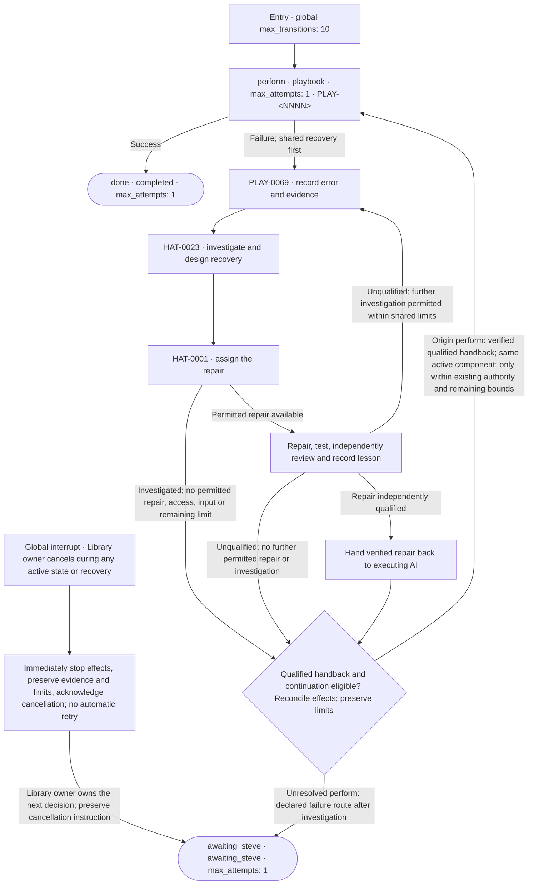

# <End-to-end process name>

## Purpose and acceptance

Complete the five-part framework below before composing steps. Workflows/README.md, "Outcome, necessary work, decisions, recovery and proof" is authoritative. Keep transitions only in workflow-json. Every bracketed value is required authoring input, never an operational default. An unfilled value or unevaluable mandatory predicate blocks approval/invocation.

### Outcome and acceptance

- Beneficiary and requested final state: <who needs what observable change>.
- Target/population/window and exclusions: <exact objects, scope, times and units>.
- Accountable owner and authority source: <identity, current grant and exclusions>.
- Acceptance: <for each workflow-local requirement key, state exact PASS predicate/tolerance, verification procedure, evidence source/revision/freshness and judgement owner/rubric if required>.
- Completion: <all mandatory predicates and governing gates must pass; populate purpose/scope/inputs/outputs/completion/persistence in workflow-json consistently>.

### Necessary work

<For each step/operation: requirement key, required downstream dependency or named risk/control; exact input; executor; permitted operation/effects; required evidence; acceptance; existing next/failure/return. Remove unmapped operations. Do not create a phase for each framework heading. Identify justified evidence reuse and required fresh checks.>

### Decisions

<For each decision: typed inputs/domains and source/freshness; exact predicates/boundaries; unique/ordered/combined match rule; explicit no-match otherwise; error/missing/stale/conflict failure route; destination; judgement rubric/owner. Apply SKILL-0320. Assess feasible states, guards, joins and waits through SKILL-0321. Do not use an unevaluated condition or missing evidence as a normal default. If there are no decision nodes, cite the actual linear mechanism and identify remaining success/failure predicates; do not invent a node.>

### Recovery

<For each material failure: detection; requirement; known/uncertain effects; cause versus uncertainty; PLAY-0069 handler/owner; request and shared budgets/deadlines; single retry owner; idempotency/reconciliation; affected re-entry and invalidated checks; no permitted continuation condition. Preserve cancellation, original acceptance, authority expiry and counters. Reference existing recovery fields instead of creating another loop.>

### Proof

<For every acceptance requirement/control: independent expected result; exact tested input/definition; method and execution owner; evidence type/location; observed result or explicit untested gap; mandatory independent reviewer and limits. Include applicable normal/failure/boundary/uncertain-effect/recovery/cancellation cases or a mechanism-based non-applicability reason. State any required efficiency measure with units, population/window/source and acceptance target; no invented baseline. Use existing tests/coverage/review and owning ledger; no duplicate proof ledger.>

## Minimum necessary execution — required authoring

Apply Workflows/README.md, Minimum necessary execution contract and Single-owner rule bindings. Fill the concrete local operation/evidence/acceptance/return fields below and identify the actual test execution owner and proof. The README owns the author/reviewer gate and shared rules; do not paste them into this record.

## Operating briefings — required authoring

Apply Workflows/README.md, Mandatory operating briefings and Single-owner rule bindings. Fill the entry and per-step control with this workflow's actual operation, required evidence, effects, acceptance and recovery/return; use the owner's qualification cases. This template does not redefine the briefing or recovery policy.

## Workflow contract

```workflow-json
{
  "schema_version": 1,
  "purpose": "<Beneficiary and exact observable final state, target/population and required deliverable>",
  "trigger": "<Exact entry condition>",
  "scope": "<Permitted systems, objects and effects>",
  "non_goals": [
    "<Explicit exclusion>"
  ],
  "inputs": [
    "<Input contract and provenance>"
  ],
  "outputs": [
    "<Required output and evidence>"
  ],
  "authority": "<Explicit current request to run this already-approved graph; declared component scope, verified actor/access, shared bounds and separate excluded-action gates under AGENTS rule6; construction or approval is not invocation>",
  "completion": "<Conjunction of every mandatory requirement predicate/tolerance and governing gate, verified against actual final outputs/target state; identify evidence oracle, revision/freshness and acceptance owner>",
  "persistence": "<Owning Ticket/Project and used plan>",
  "risks": [
    "<Residual risk and owner>"
  ],
  "grill_me": "SKILL-0318",
  "entry": "perform",
  "max_transitions": 10,
  "steps": [
    {
      "id": "perform",
      "kind": "playbook",
      "owner": "HAT-0001",
      "actor_access": "<Exact operator identity and verified access>",
      "scope": "Allowed operations: <finite named reads, computations and authorised actions for this exact Playbook phase slice>. Excluded: <explicit effects and unrelated work>. No operation may be inferred from naming the whole Playbook.",
      "prerequisites": [
        "<Required source evidence and permission>"
      ],
      "inputs": [
        "Required evidence: <exact inputs/source identities, current actor/authority/access, required freshness, and reusable check receipts>.",
        "Test execution owner and group: <named person/agent, distinct assertions, input revision and one evidence location>."
      ],
      "outputs": [
        "Required deliverable and proof: <named output, exact observable result and existing ledger/evidence pointer; no duplicate narrative>."
      ],
      "allowed_effects": [
        "<Explicit permitted effects>"
      ],
      "success_check": "<All observable phase acceptance conditions and mandatory governing gates>. Apply Workflows/README.md, Minimum necessary execution contract, to this phase acceptance and declared next/return.",
      "recovery": "Apply this workflow's shared failure_handling bindings to this step's actual failure/effects before its declared failure destination.",
      "max_attempts": 1,
      "controls": [
        {
          "requirement": "Apply Workflows/README.md, Mandatory operating briefings, at this declared step; bind <actual operation, applicable evidence, effects, acceptance and recovery/return>. The existing entry step applies the opening briefing.",
          "mode": "instruction",
          "evidence": "<Current applicable contract and actual run evidence pointers; recover missing context before dependent effects, never a read tick or invented prior success>.",
          "critical": true
        },
        {
          "requirement": "Apply Workflows/README.md, Minimum necessary execution contract, Rule 1, to this step's declared operations and evidence.",
          "mode": "instruction",
          "evidence": "<Affected requirement, source identity/freshness and existing proof pointers; Workflows/README.md minimum contract>.",
          "critical": true
        },
        {
          "requirement": "Apply Workflows/README.md, Minimum necessary execution contract, Rule 2, to this step's declared operations and evidence.",
          "mode": "instruction",
          "evidence": "<Owner/assertions/input/result receipt and any justified repeat; no invented execution>.",
          "critical": true
        },
        {
          "requirement": "Apply Workflows/README.md, Minimum necessary execution contract, Rule 3, to this step's declared operations and evidence.",
          "mode": "instruction",
          "evidence": "<Filled scope/input/output/success/recovery fields and actual phase result>.",
          "critical": true
        },
        {
          "requirement": "Apply Workflows/README.md, Minimum necessary execution contract, Rule 4, to this step's declared operations and evidence.",
          "mode": "instruction",
          "evidence": "<One necessary entry or explicit no-extra-work disposition; verified route/polling plan if applicable>.",
          "critical": true
        }
      ],
      "uses": "PLAY-<NNNN>",
      "capabilities": [],
      "next": "done",
      "failure": "awaiting_steve",
      "playbook": "PLAY-<NNNN>"
    },
    {
      "id": "done",
      "kind": "terminal",
      "owner": "HAT-0001",
      "actor_access": "<Exact operator identity and verified access>",
      "scope": "Allowed operations: verify the declared prior output/evidence receipts and return completed immediately. Excluded: new effects, tests, polishing or another completion gate.",
      "prerequisites": [
        "<Required source evidence and permission>"
      ],
      "inputs": [
        "Required evidence: <completed prior phase receipts and actual deliverable identities; do not rerun their accepted checks without Rule 2 reason>."
      ],
      "outputs": [
        "The declared final deliverable and one completion/evidence pointer."
      ],
      "allowed_effects": [
        "<Explicit permitted effects>"
      ],
      "success_check": "<Actual final deliverable predicates and mandatory prior-gate evidence>. Apply Workflows/README.md, Minimum necessary execution contract, to this completed return.",
      "recovery": "<Preserve effects/evidence; safe re-entry and owner>",
      "max_attempts": 1,
      "controls": [
        {
          "requirement": "<Required control>",
          "mode": "unverified",
          "evidence": "<Actual location/evidence or explicit gap>",
          "critical": true
        }
      ],
      "outcome": "completed",
      "playbook": "PLAY-<NNNN>"
    },
    {
      "id": "awaiting_steve",
      "kind": "terminal",
      "owner": "HAT-0001",
      "actor_access": "Apply PLAY-0069 Two-outcome service contract to the available read-only operator and evidence.",
      "scope": "Apply PLAY-0069 Two-outcome service contract to <actual reporting operation and source/run evidence>.",
      "prerequisites": [
        "<Actual failure, unresolved input/decision or explicit cancellation evidence; apply PLAY-0069 Two-outcome service contract>."
      ],
      "inputs": [
        "Available source/run evidence, exact known/uncertain effects, repair/handback history and remaining limits."
      ],
      "outputs": [
        "The actual handoff packet defined by PLAY-0069 Two-outcome service contract, populated from <this workflow's observed result and unresolved dependency>."
      ],
      "allowed_effects": [
        "Apply PLAY-0069 Two-outcome service contract to <the actual terminal handoff operation>."
      ],
      "success_check": "Apply PLAY-0069 Two-outcome service contract to the actual result; identify <the observable terminal evidence and packet location>.",
      "recovery": "Apply PLAY-0069 Two-outcome service contract and Active-phase continuation versus re-entry to the actual stopped attempt and next-entry evidence.",
      "max_attempts": 1,
      "controls": [
        {
          "requirement": "Apply PLAY-0069 Two-outcome service contract to this terminal reporting operation.",
          "mode": "instruction",
          "evidence": "Available source and observed failure evidence; required specialist review before approval.",
          "critical": true
        }
      ],
      "outcome": "awaiting_steve",
      "playbook": "PLAY-0069",
      "handoff": {
        "question": "Apply PLAY-0069 Two-outcome service contract: <actual remaining Library owner-owned need or cancellation acknowledgement>.",
        "why_needed": "Apply PLAY-0069 Two-outcome service contract: <actual blocked dependency and why accessible sources cannot settle it>.",
        "investigated_options": "Apply PLAY-0069 Two-outcome service contract: <actual investigation, assigned work, alternatives and outcomes, or applicable cancellation evidence>.",
        "recommendation": "Apply PLAY-0069 Two-outcome service contract: <smallest evidenced next choice and its effect>.",
        "owner": "Library owner",
        "preserved_effects": "Apply PLAY-0069 Two-outcome service contract: <actual owner, executing AI, source/run, known or uncertain effects and retained evidence>.",
        "remaining_limits": "Apply PLAY-0069 Two-outcome service contract: <actual used and remaining request, phase, transition, controller and candidate limits>.",
        "next_entry": "Apply PLAY-0069 Two-outcome service contract: <actual required answer or state change and applicable entry gates>.",
        "cancellation": "Apply PLAY-0069 Two-outcome service contract: <actual cancellation instruction and acknowledgement, when present>."
      }
    }
  ],
  "dependencies": {},
  "pins": {},
  "policy_pins": {},
  "resource_pins": {},
  "tests": [],
  "gaps": [
    "Draft: replace placeholders, settle decisions, test and obtain independent review.",
    "Draft: bind every step to a real Playbook; complete requirement-to-Skill coverage and resolve all material component gaps before approval."
  ],
  "review": {},
  "coverage": {},
  "failure_handling": {
    "playbook": "PLAY-0069",
    "director": "HAT-0023",
    "coordinator": "HAT-0001",
    "error_tracking": "Apply Playbooks/PLAY-0069-workflow-qualification-and-recovery.md, Mandatory tracked repair and execution handback, step 1, to the actual failed step/run/source and defect owner.",
    "repair_loop": "Apply Playbooks/PLAY-0069-workflow-qualification-and-recovery.md, Mandatory tracked repair and execution handback, steps 2–4, to the failed requirement and affected local components.",
    "handback": "Apply Playbooks/PLAY-0069-workflow-qualification-and-recovery.md, Mandatory tracked repair and execution handback, step 5, to the executing AI, verified evidence and actual next result.",
    "continuation": "Apply Playbooks/PLAY-0069-workflow-qualification-and-recovery.md, Active-phase continuation versus re-entry, to the exact originating operation and its governing component gate.",
    "child_return": "Apply Playbooks/PLAY-0069-workflow-qualification-and-recovery.md, Two-outcome service contract, to the actual child result and parent return gate.",
    "limits": "Apply Playbooks/PLAY-0069-workflow-qualification-and-recovery.md, Method, step 7, to the actual controller budget; apply the governing component budget separately.",
    "awaiting_steve": "Apply Playbooks/PLAY-0069-workflow-qualification-and-recovery.md, Two-outcome service contract, to the actual remaining Library owner-owned need or cancellation acknowledgement.",
    "continuation_target": "failed_step_continuation",
    "cancellation_policy": "immediate_stop_acknowledgement"
  }
}
```

## Review, tests and change history

<Source/date, settled decisions, findings, corrections, actual expected/observed results, independent reviewer identity and limitations. No approved or runtime claim until evidenced.>

## External execution-route evidence

<For each external effect record: exact native trigger and inputs; actual callable tool/UI/worker; actor/access evidence; exact-result run/status/artifact readback; supported alternatives and bounded recovery owner. Reference this procedure in the graph's actor_access, prerequisites, controls, success_check and recovery fields. Per-run values belong in the owning ledger. If no external effect applies, state the evidenced reason.>

<Record actual Guardrail, Reliability and applicable Security findings, contributor identities, evidence and limits. Distinguish source qualification, current-environment eligibility and actual completion. Missing required operational proof blocks feasibility; linked Hats and safe refusal alone do not prove review or exhausted recovery.>

## Service-failure evidence

<For required external reads state tested retryable/permanent classes, per-request and total deadlines, attempt/page budgets, backoff, complete-result verification and exhaustion owner. Include transient-then-success, later-page failure, permanent denial, malformed evidence and unknown write-effect cases. Do not equate a successful-response mock with recovered service behaviour or read failure with absence. Preserve separate request and candidate repair limits.>

## Failure feedback loop qualification

Apply Playbooks/PLAY-0069-workflow-qualification-and-recovery.md, Mandatory tracked repair and execution handback, and Skills/SKILL-0313-reusable-workflow-specification.md, Qualify the complete failure feedback loop. Record <executing AI, canonical work/defect owner, case inputs, independently expected decisions/packets, actual results and evidence>. Include deduplication/recurrence, missing tracker or handoff, repair-only versus target-success evidence and remaining invocation/budget cases.

## Source work versus declared operational request

Use SKILL-0313 Existing native control transport and PLAY-0056's exact validation-request contract when applicable. Test a corrected already-staged source tree independently from its intentional same-tree request commit; source-only children never trigger it. Current authority, completed child, relevant reviewed correction, correct failed/validated boundary, complete first-request/failed-tree evidence, exact tree/sole parent/lease/message and original receipt/full-range validation remain mandatory. Do not invent source edits, reset budgets, rerun an unresolved tree or infer execution from a commit. New operational modes require explicit contracts, actual primitive/refusal tests and separate source acceptance before use; absence of one browser/dispatch tool is not proof all native routes are unavailable.

## Maintained visual workflow

Every workflow built or edited must include and maintain one visual generated from its exact workflow-json contract by check_workflows.render_visual. Regenerate it after every structural change; run the parity check and independent semantic review before approval. Missing, duplicate, altered or stale visuals fail admission. Show the actual entry, all states and branches, nested calls, waits and limits, the shared error/Director/Head/repair/test/review/lesson/verified-handback loop, cancellation and the two service outcomes: completed and awaiting_steve. Do not maintain a separate hand-drawn graph. Exact structural parity is a checkable requirement; it does not establish runtime completion or justify an unmeasured confidence claim. Record rendered readability separately from topology and runtime evidence.

<!-- workflow-visual:start -->

<!-- workflow-visual:end -->
